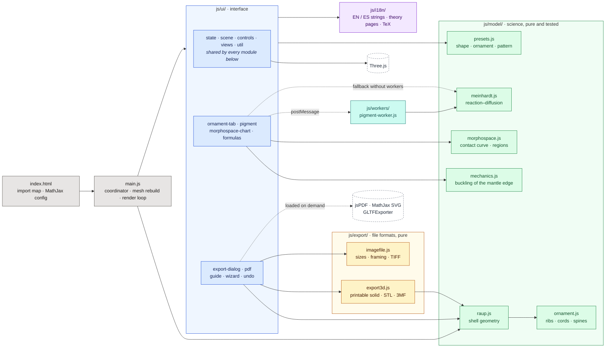
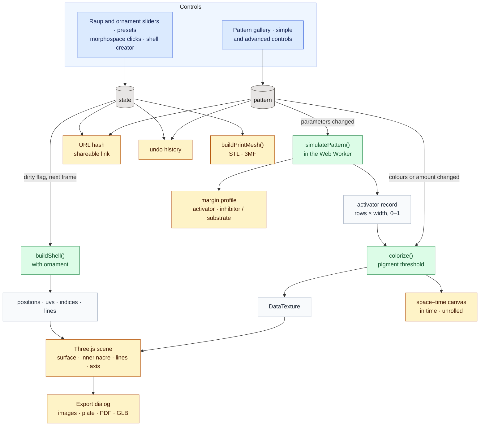

# Architecture

Technical notes for anyone who wants to understand, modify or extend the app. The scientific background and the user guide are in the [README](README.md).

## Technology

The app is a static web page: HTML, CSS and JavaScript ES modules, with no build step and no runtime dependencies to install.

- **Three.js 0.160** (WebGL), loaded from jsDelivr through an *import map* in `index.html`. Add-ons used: `OrbitControls`, `RoomEnvironment`, `LineSegments2` / `LineMaterial`, `Line2` / `LineGeometry`, and `GLTFExporter` (imported on demand).
- **MathJax 3** for the formulas, also from jsDelivr.
- **jsPDF 4.2.1**, loaded from jsDelivr only when a PDF is exported.
- Inter and JetBrains Mono fonts from Google Fonts.
- **Node.js ≥ 20** only for development. The test suite (`npm test`) uses the built-in `node:test` runner and needs no dependencies. `npm ci` installs the development dependencies of `package.json`: ESLint and Prettier (`npm run lint`), and Three.js, MathJax and jsPDF at exactly the versions loaded from the CDN, which the browser test serves locally.

## Layout

```
index.html            Page, Three.js import map and MathJax configuration
favicon.svg           Icon (an ammonite drawn with a logarithmic spiral)
css/                  Styles, loaded in cascade order by index.html:
  base.css            Colour tokens (automatic light/dark theme), base rules, page layout, reduced motion
  sidebar.css         Sidebar: parameter controls, collapsible sections, tabs, pigment tab and gallery
  viewer.css          3D view: toolbar, views bar, equation panel, overlaid charts, responsive layout
  dialogs.css         About, export, welcome guide and shell creator
js/main.js            Coordinator: rebuilds the mesh, shape presets, tabs, language, render loop,
                      and connects the modules below (their init functions)
js/model/             The science, pure modules without DOM or Three.js (tested in Node)
  raup.js             Geometry: parametric mesh, UVs, lines, mirror valve, normalisation
  ornament.js         Ornament: ribs, cords, keel, spines and change with growth
  mechanics.js        Mechanical model of the cords: buckling of the mantle edge
  challenge.js        Match-the-shell challenge: silhouettes, score, hints, levels, targets (pure)
  meinhardt.js        Pigmentation: Meinhardt's reaction–diffusion models
  morphospace.js      W–D morphospace: contact curve and occupied regions
  presets.js          Shape, ornament and pigmentation presets
js/export/            File formats, pure
  export3d.js         3D printing: closed solid with a real wall, binary STL and 3MF
  imagefile.js        Image export: fixed sizes, reframing, plate layout, file names, TIFF encoder
js/ui/                The interface, one module per part
  util.js             Small shared helpers ($, number formats, colours, seam normals)
  state.js            State of the shell and view, control definitions, page address, storage
  scene.js            Renderer, camera, lights, materials, meshes, display group, axes gizmo
  controls.js         Slider controls (createParam) and the shape, geometry and line sliders
  views.js            Standard views, display orientation, free rotation, ground
  formulas.js         Equation panel and About window
  morphospace-chart.js  W–D chart in the sidebar, over the 3D view and in the PDF
  ornament-tab.js     Ornament tab and the panel of the mechanical model
  pigment.js          Pigment tab: simulation in a worker, space–time record, profile, gallery
  export-dialog.js    Export window: images at any size, plate, PNG/JPEG/TIFF, STL, 3MF, GLB
  pdf.js              PDF sheet (jsPDF and MathJax SVG loaded on demand)
  guide.js            Welcome guide with its own small 3D scene
  wizard.js           Create your own shell: the step-by-step window
  challenge.js        Challenge: match the shell (window, levels, check)
  undo.js             Undo history
js/workers/
  pigment-worker.js   Web Worker that runs meinhardt.js off the main thread (loaded by ui/pigment.js as ../workers/pigment-worker.js; if it cannot load, the pattern and the gallery thumbnails are computed on the main thread)
js/i18n/
  i18n.js             t(), language switch and applyStatic(); merges the files below
  en.js · es.js       Short interface strings, parameter and preset names
  theory-en.js · theory-es.js   The long About pages (theory, controls, credits)
  tex.js              Formulas (TeX) and reference lists shared by both languages
tests/*.test.mjs      Automated tests (node:test); browser.test.mjs drives the real interface in headless Chrome
docs/README.es.md     Spanish translation of the README
docs/introduccion-divulgativa.md  Non-technical introduction in Spanish
docs/images/          Images used by the documentation
package.json          Scripts (test, lint, format) and development dependencies (npm ci)
eslint.config.js · .prettierrc.json · .prettierignore   Linter and formatter settings
.git-blame-ignore-revs  Formatting-only commits that git blame skips
.github/workflows/    Continuous integration: lint, then tests on Node 20, 22 and 24
```

The modules marked *pure* do not depend on Three.js or the DOM, so they run unchanged in the browser, in the Web Worker and in Node (tests).

## How the program works

### Modules

The interface lives in `js/ui/`, one module per part; the science lives in `js/model/` and the file formats in `js/export/`, as pure modules that the tests import directly. The pattern simulation runs in a Web Worker so that dragging a slider never freezes the interface.

**How the interface modules are connected.** Shared values that never change identity (the `state` object, the scene, the meshes and materials) are imported directly from `state.js` and `scene.js`. A value that a module reassigns, such as the computed pattern in `pigment.js` or the viewport in `scene.js`, is exported as a live binding and changed only by its own module (`setViewport`). Each module that needs functions from other parts exports an `init…(ctx)` function: `main.js` calls it once, at the wiring point near the end of the file, passing those functions (and getters such as `live.lastBuild()` for values that `main.js` reassigns). Event listeners and the controls of each part are created inside its `init`, so nothing runs before everything it depends on exists. `main.js` keeps the mesh rebuild and the render loop, the shape presets, the tabs and the language switch.



| Colour | Role |
|---|---|
| Grey | Entry point and coordination: the page and `main.js` |
| Blue | Interface (`js/ui/`): DOM, Three.js scene, controls and windows |
| Green | The science (`js/model/`): pure functions, no DOM, covered by the tests |
| Amber | File formats (`js/export/`): pure, covered by the tests |
| Purple | Texts (`js/i18n/`) |
| Teal | Web Worker: the pigmentation model off the main thread |
| White, dashed | External libraries from a CDN |

Solid arrows are imports; dashed arrows are messages to the worker or libraries loaded only when needed. Within `js/ui/`, the blue base modules are imported by all the others.

### Data flow

Every control writes to one of two state objects: `state` (shape and appearance) or `pattern` (pigmentation). The shape is rebuilt at most once per frame. The pattern is simulated only when one of its parameters changes, and simply repainted when only its colours or threshold change. While a slider is dragged the pattern follows it: `schedulePattern` waits for the running simulation and then starts another with the latest values (`patternPending`), so the record updates at the pace of the simulation instead of only when the slider is released; a preset or a new seed discards a busy worker instead.



Blue: what the user moves. Grey: the two state objects. Green: computation. Light grey: intermediate data. Amber: what the user sees or takes away.

## Geometry (`js/model/raup.js`)

`buildShell(params)` is a pure function: it takes the parameters and returns typed arrays ready for the GPU.

1. **θ × φ grid.** θ runs from −2πN to 0 with `segPerTurn` steps per whorl; φ goes around the aperture with `segPhi` steps. Each point follows Raup's equation, with growth factor `g = W^(θ/2π)`.
2. **Mirror valve.** If `mirror` is set, the vertices are duplicated and reflected (y → −y), and the winding of the copy is reversed so its normals still point outwards.
3. **Normalisation.** The shell is centred and scaled so that its largest dimension equals `size`, so the camera never needs to reframe. The complete shell is always used, even while the growth animation shows only part of it, so the scale does not change as it grows.
4. **Triangles.** Each grid cell is split into two triangles, with front faces pointing out of the tube: both the dextral sense and the mirror reflection reverse the winding, and `raup.js` compensates for both.
5. **Lines.** Spiral lines have constant φ; growth lines have constant θ (successive positions of the aperture). Rings are counted from the aperture towards the apex so that the final aperture always has one.
6. **Vertex colours** for the growth bands of the solid mode.
7. **Texture coordinates.** u is the **arc length** along the elliptical aperture (not the angle φ), so the cells of the pigmentation model are evenly spaced along the real margin, also when S ≠ 1. v is uniform in θ (0 at the apex, 1 at the aperture). The column φ = 2π repeats φ = 0 so the texture does not wrap inside the last triangle; the viewer then averages the normals of that seam (`fixSeamNormals`) so it is invisible under lighting.

It returns `positions`, `colors`, `uvs`, `indices`, `lineIndices`, the position of the coiling axis, the derived values (r_c, a, b), the grid layout and statistics.

### Axis convention

The equation uses a right-handed frame (x, y, z) with z as the coiling axis. Three.js uses Y up, so the mapping is:

```
X = x      Y = z      Z = −y
```

With this mapping, the internal parameter `hand` (+1 dextral, −1 sinistral) equals −ε in the equation. The axes gizmo draws x, y, z of the mathematical frame, not of Three.js.

### Density at high W

In bivalves (W from 10² to 10⁴) almost the whole valve lies in the last fraction of a whorl. To keep the mesh and the growth lines dense enough, `main.js` multiplies `segPerTurn` and `ringsPerTurn` by `max(1, log10 W)`.

## Pigmentation (`js/model/meinhardt.js`)

`simulatePattern(params, geometry)` is a pure function that returns `{ values, second, state }`: a `rows × width` matrix of activator between 0 and 1 (row 0 is the apex), the second substance (`rows × PROFILE_WIDTH`, relative to its maximum) and a diagnosis `state` (`'pattern'`, `'uniform'` or `'extinct'`).

- **Models.** Meinhardt's activator–inhibitor and activator–substrate models, with saturation κ. The second one supports global control: a signal `c` that follows the mean activity of the margin and raises the basal production when activity drops (`b_a + g / (1 + 40c)`), a simplified version of the mechanism of Meinhardt and Klingler (1987) for the triangles of *Oliva*. In this form it gives oblique lines and V shapes but not the full *Oliva* pattern, so there is no *Oliva* preset.
- **Periodic margin** of up to 256 cells, with a discrete Laplacian (Δx = 1).
- **Integration.** Explicit Euler with time step `dt = min(0.5, 0.4/D_max, 0.4/r_max)`, stable for diffusion. Values are clamped so that extreme parameters cannot overflow.
- **Time.** Every row gets the same time (`T / rows`): a logarithmic spiral traversed at a constant angular rate is growth at a constant relative rate.
- **Cell insertion.** Optional: the margin has `256 · W^(θ/2π)` cells (at least 8). Each new cell duplicates a randomly chosen neighbour, with its own source density. Each row is resampled to the texture width.
- **Noise.** The source density of each cell is `r_a · (1 ± noise)`, drawn from a seeded pseudo-random generator (mulberry32): the same seed always gives the same pattern.
- **Normalisation.** Robust scaling between the 2nd and 99.5th percentiles, ignoring the first quarter of the rows (the initial transient at the apex), so that one isolated peak does not dim the rest. If the activator dies out (`hi < 1e-4`) or the margin stays practically uniform (`(hi − lo)/hi < 5 %`), nothing is rescaled, because amplifying tiny differences would fabricate a false pattern; the interface shows a message instead.

In `js/ui/pigment.js` the result is coloured with a **pigmentation threshold**, as in Meinhardt's simulations: pigment where the activator exceeds `1 − amount`, with a short transition (a smoothstep of half-width `PIGMENT_EDGE = 0.12`) so edges are sharp but not jagged. Because cells are resampled linearly to texels before thresholding, edges fall with sub-cell precision. The texture is a 1024 × 2048 `DataTexture`; the same image is drawn on the space–time canvas of the tab. The simulation only runs again when its parameters change or, with cell insertion, when W or N change; changing colours only repaints. It runs in a module Web Worker, or on the main thread if workers are unavailable.

- **Two views of the record.** *In time* draws the record as computed: every whorl gets the same height and every row is normalised to the full width. *Unrolled shell* (`unrolledImage`) draws each row with a width ∝ g = W^(θ/2π) at a height ∝ g − g0, because the distance travelled from the apex is also ∝ g. The result is a straight-sided fan with height/width ratio v·(1 − g0)/(k·P), where k = ln W/2π, v is the advance of the aperture centre per radian and P its perimeter. It is approximate: the outer side of a whorl grows faster than the inner side. `rowToFrac` and `fracToRow` convert between rows and heights for the profile marker.
- **Margin profile.** In the advanced view, clicking or dragging on the space–time record chooses a moment; a canvas plots there the activator, the second substance and the pigment threshold, and shades the pigmented area.
- **Tab flow.** Entering the pigment tab switches to solid mode (no lines), but the shell keeps its plain colour: the user picks the pattern. A gallery shows the solid-colour option and each preset with a real thumbnail, computed once in a separate worker.
- **Simple and advanced controls.** The simple controls are real quantities of the model, not hidden multipliers: *pattern size* sets the number of margin cells (`nMax = 256 / size`), *growth time* is `T`, *irregularity* is `noise`, and *pigment amount* only shifts the colouring threshold (without simulating again). The advanced view adds the model, all its constants and cell insertion. Constants use logarithmic sliders (`log: true` in `createParam`); with `zero: true` the leftmost position is exactly 0. Dragging a logarithmic slider rounds the value to what is displayed (two significant figures), so the visible value is always the real one and a pattern can be reproduced by typing its numbers. Changing the model loads its default constants (`MODEL_DEFAULTS` in `presets.js`), keeping colours, size and amount: the *Nautilus* preset for the activator–inhibitor model, and an excitable set without saturation that draws travelling waves for the activator–substrate model.
- **Stale computations.** If a new computation arrives while the worker is busy, the worker is terminated and a new one is started: when dragging a slider only the last value matters.
- **Outside and inside.** The outside (`FrontSide`) carries the colour or the pattern; the inside (`BackSide`) uses a light `MeshPhysicalMaterial` with some iridescence, like nacre.
- **Equations.** The *Equation* panel has two views, Raup and Meinhardt. The Meinhardt view shows the equations of the active model and the same equations with the current values, omitting zero terms.

## Morphospace (`js/model/morphospace.js`)

- **Contact curve.** For T = 0 the inner edge of a whorl lies at distance g·D from the axis and the outer edge of the previous whorl at g/W, so they touch exactly when D = 1/W, for any S. The tests check this numerically with `buildShell`.
- **Regions.** Polygons in (log W, D) that start at D = 0. Gastropods and bivalves are half-ellipses; ammonoids and nautiloids are a band below D = 1/W (whorls in contact or overlapping). They are approximate and do not reproduce published numerical outlines.
- **Section of the cube.** The plane is a section at the current T, so each region has `tOk(T)`; regions that fail it are drawn faded.
- **Interaction.** In `js/ui/morphospace-chart.js`, the group names are links (`labelBoxes`) that load the typical preset of the group; clicking anywhere else changes only W and D. The W axis can span 1–10 or 1–10⁴ (`MORPHO.logMax`).

## Rendering (`js/ui/scene.js`, `js/ui/views.js` and the render loop in `main.js`)

- **Modes.** *Lines* draws only the lines; *Solid* the surface with `MeshStandardMaterial`, a directional light with soft shadows, a hemisphere light and an environment map (`RoomEnvironment`); *Both* draws both.
- **Lines with a width.** Native WebGL lines are always 1 px wide, so `LineSegments2` with `LineMaterial` is used. The coiling axis is a dashed `Line2` whose width (`state.axisWidth`, 1 px by default) can be changed.
- **Hidden-line removal.** In *Lines* mode the surface is drawn with `colorWrite: false`: it only writes to the depth buffer and hides the back lines. A `polygonOffset` pushes the surface back slightly so the visible lines do not flicker.
- **Axes gizmo.** A second scene with an orthographic camera that copies the orientation of the main camera and is drawn in a corner with `setScissor` / `setViewport`.
- **Standard views.** The transition interpolates the camera position in spherical coordinates (azimuth and elevation separately), so the orientation stays continuous even at the apical and umbilical views, which look along the vertical axis. Pending `OrbitControls` inertia is consumed first so the camera does not spin afterwards.
- **Portrait screens.** On mobile the vertical field of view is widened to keep the horizontal framing.
- **Rebuilds.** Any control marks the mesh as dirty and it is rebuilt once on the next frame, even if several values changed.

## Interface

- **Parameters.** `createParam` builds each control (synchronised slider and number box). W has a linear (1–10) and a logarithmic (1–10⁴) scale, and switches to the logarithmic one when its value exceeds 10.
- **Overlaid charts.** The *Graphs* menu of the viewer toolbar (a `<details>` element) toggles two panels on the 3D view, off by default: the morphospace (interactive) and the margin profile, with a slider that chooses the moment (`profileRow`, shared with the advanced view). `drawMorphoOn(canvas)` and `drawProfileOn(canvas, row)` draw on any canvas, also off-screen for the PDF. *Hide info* mode hides them too.
- **Formulas.** MathJax is configured with `startup.typeset: false`; each formula is typeset when its panel becomes visible, through a promise queue so two typesetting jobs never overlap.
- **Languages.** `js/i18n/` holds every string: short interface strings in `en.js` and `es.js`, the long About pages in `theory-en.js` and `theory-es.js`, and the formulas and references shared by both in `tex.js`. In the HTML, the `data-i18n`, `data-i18n-html` and `data-i18n-title` attributes mark what to translate; everything else (parameters, presets, morphospace, charts) is translated from `main.js`. The page opens in English, or in the language chosen on a previous visit. The choice is stored in `localStorage` through a small `storage` wrapper that does nothing if storage is unavailable.
- **State in the URL.** The current shell is stored in the hash (`#W=2.4&D=0.08&T=1.6&S=1&N=4.5&h=1&v=0&m=lines`) with `history.replaceState`, so copying the address shares the shell. With a pattern applied, `pg=1` and its parameters are added (`pm`, `pDa`, `pD2`, …, `ps` for the seed, `pi` for insertion and `pcb`/`pcp` for the colours). The look follows: `lc`, `sc` and `bg` (line, shell and background colours, in hex without `#`) once a colour has been chosen or came in a link, `q` for a mesh resolution other than medium, `bd=0` without growth bands and `ax=1` with the axis shown. `main.js` writes them through the `lookHash` hook of `setHashHooks` and applies them on load (`lookFromHash`).
- **Tabs.** The sidebar has three tabs (Shape, Ornament and Pigment), each with a *Theory* link to its page of the About dialog, which has five pages (Raup, Meinhardt, Ornament · mechanics, Controls and Credits). The pages contain only theory, controls and credits; technical details live only in this document. Each page is typeset with MathJax the first time it is shown. Secondary sections of the sidebar are `<details class="drawer">`: geometry (open by default), the pigment colours and, in the ornament tab, ribs, cords, spines, keel and change with growth, which have equal rank; `openActiveDrawers` (ornament-tab.js) opens the ones the shell has whenever the relief is replaced (an example, undo, removing it) and never folds one while a slider is moved. The sidebar's scrollbar is thin and in the theme colours, visible only while the pointer is over it.
- **Welcome guide** (`js/ui/guide.js`, `#welcome`). Opens on the first visit, unless the page was opened from a shared link (a hash with shape or pattern), always when the address contains `?guide`, and again from the *Guide* button; closing it stores `coiling-shells.welcome` in `localStorage`. It has its own small Three.js scene (`buildWelcome`, built the first time it opens) with a snail generated by `buildShell` (`GUIDE_SHAPE`, a garden snail with a taller spire) with a relief added (`GUIDE_ORNAMENT`: reticulate ribs and cords, and a row of spines on the shoulder) in a plain shell colour, `OrbitControls` for rotation which turn it when dragged. The labels of the parts (`shellAnchors`) are anchored to points of the generated mesh: apex, spire, suture, body whorl, aperture (centre of the last ring), coiling axis, a rib and a cord (crests on the last whorl) and a spine (a spine tip, which is a mesh vertex). The suture is computed exactly: two rings one turn apart lie in the same meridian plane, and the crossing of their outlines farther from the axis is the suture seen from outside. The umbilicus is not labelled: it is barely open and only visible from below. Parts that run along a whorl have several candidate points; every few frames each label moves to the closest candidate that is not hidden (for the spine, the one seen most in profile, so it is not foreshortened), tested by ray casting against a coarse copy of the shell, and labels with no visible candidate are faded. When one side of the shell gathers too many labels, those closest to the centre move to the other side; then the labels are spread vertically on each side so they never overlap, also near the top edge. The scene only renders while the guide is open, and the main viewer pauses meanwhile. Beside the shell, six numbered steps (`wel.s1`–`wel.s6`) explain the app: shape, view, colour, learn and export, the shell creator and the challenge.
- **Relief settings only when the relief is there.** `ORNAMENT_NEEDS` (ornament.js) says which settings need which kind of relief: the height, width, asymmetry and position of ribs, cords and spines need at least one of them, and the keel's width and position need a keel height. `syncPresence` (controls.js), called from `markDirty` and before each rebuild, adds the `absent` class (`display: none`) to every slider bound to such a key while its count is 0, in the ornament tab, the shell creator and the challenge alike; the nodules box (which needs ribs and cords) and the second row of spines follow the same rule.
- **Fullscreen and hide info.** Fullscreen uses the Fullscreen API on the viewer container. *Hide info* adds the `clean` class to `<body>`, which hides everything except the canvas and a button to come back.
- **Pointer capture.** `capturePointer` wraps `setPointerCapture`, which throws if the pointer is no longer active (e.g. a cancelled touch).

## Ornament and display orientation

- **Ornament** (`js/model/ornament.js`, used by `buildShell`). The generating curve is displaced along its outward normal in the meridian plane, n ∝ (b cos φ, a sin φ), by g·a·δ, so the relief scales with the aperture. δ = f(s)·[h_r R(θ) + h_c C(u) + h_k K(u) + h_s Σ(θ,u)]: axial ribs (cos² bumps in θ, counted from the final aperture, with an optional skew for varices), spiral cords in the arc-length coordinate u, a keel (one cord at u_k), spines (cones at n_s positions per whorl in one or two rows; a spine is drawn only if it lies whole behind the lip and where the shell is no longer tiny: after the first whorls (one, or 30 %) or, if that comes earlier, beyond 20 % of the final size, `SPINE_MIN_SIZE`, which is what lets single-whorl bivalves carry spines; its tip is snapped to a mesh column) and a growth factor f(s) = clamp(1 + c(2s − 1), 0, 2). With nodules, ribs and cords multiply. `makeOrnament` precomputes the per-column normals and profiles; `ornamentResolution` asks for about six segments across each rib, cord and spine base, which `rebuild` honours within a budget of 500 000 vertices (the printable solid has its own row limit). The pattern coordinates (u, v) do not change, so pigmentation lies on top of the relief. `makeOrnament` also returns the crests (rib angles, cord and keel positions, spine centres and base half-widths); with ornament, `buildShell` draws the growth lines on the rib crests, the spiral lines on the cord crests, and each spine as its base outline and two profiles through the tip. Ornamented presets (`ORNAMENT_PRESETS` in `presets.js`) carry Raup's parameters of the real shell as well as its relief.
- **Mechanical model of the cords** (`js/model/mechanics.js`). The mantle edge is an elastic rod (bending stiffness B) on a Winkler foundation (stiffness k) around a margin of length L₀. The buckling load P(n)/P_c = ½[(n/n*)² + (n*/n)²], with n* = Λ^¼/2π and Λ = kL₀⁴/B; `firstMode` picks the whole number of waves with the lowest load, `unstableBand` the range unstable under a load η = P/P_c, and the cord height grows as 0.08·√(η − 1). The panel in the ornament tab draws the curve and the buckled margin on a canvas, and `mechanicalCords` turns the result into cords with a sinusoidal profile.
- **Appearance** lives in a toolbar menu (`#lookMenu`), not in a tab, because it affects every tab; the toolbar menus close one another, on a click outside and on Escape.
- **Display orientation.** The meshes, lines and axis are children of `shellGroup`; its quaternion is a presentation transform only. *Vertical* is the identity (OrbitControls orbits around the coiling axis). *Horizontal* turns the axis towards the 3/4 camera, so the plane of coiling stands upright and a horizontal drag shows a planispiral shell face-on. *Free* disables the orbit rotation and turns the group about the screen axes on drag (zoom and pan stay with the camera). The ground is moved to the lowest rotated vertex, the axes gizmo turns with the group, and the standard views are rotated with the base orientation (in free mode a standard view first sets the shell upright). The plate of views resets the group to the model frame while it renders; the GLB, STL and 3MF exports never use it.

## Shell creator

`#wizard` is a modal window with five steps (shape, ornament, colour, look, export). It does not have its own scene or renderer: `openWizard` moves the app's canvas into `#wizView` with `setViewport`, so `resize`, the render loop, the orbit controls, free rotation and `renderViewImage` all use the window's view; closing it moves the canvas back. Its sliders are ordinary `createParam` controls (ids `wz-…`, with plain-language names `wzW`, `wzD`…) bound to the same `state`; their `onChange` updates the matching sidebar control and calls the same handlers (`onShapeChange`, `onOrnamentChange`). Menus, colours and toggles set the sidebar inputs and dispatch their events, so every change goes through one code path, is recorded by undo and written to the URL. `syncWizard` refreshes the window from the state when a step is shown or after undo. The export step calls `renderViewImage` at the screen size, `exportPDF`, or `openExport`.

## Challenge

`#challenge` is a modal window built like the shell creator: `openChallenge` moves the app's canvas into `#chView`, and its sliders are `createParam` controls (ids `ch-…`) bound to `state`. The game logic is the pure module `js/model/challenge.js`:

- **Levels** (`LEVELS`), from easier to harder. They come in three blocks (`block`: `shape`, `ornament`, `colour`), shown as numbered steps in one box per block. The free parameters are grouped in boxes like the categories of the main interface (Raup parameters, geometry, ribs, cords, spines, pattern, pigment colours; `GROUP_OF` in ui/challenge.js), and a box is shown only when the level frees one of its parameters. The result of *Check* (likeness and hint) sits between the scrolling controls and the buttons, so it is always in view. Each lists its free parameters (`keys`), what its score judges (`parts`: `shape`, `relief`, `colour`), the score to pass (`pass`, 85 → 90) and how far targets vary (`vary`, `always`); `vague` levels give hints that name the parameter but not the direction until it is close. The levels: W; W, T; W, D, T; the whole shape with the coiling direction (targets always varied, vague hints); the relief (`ribN`, `ribH`, `cordN`, `cordH`, `spineN`, `spineH`) of an ornamented shell whose shape is given; its shape and relief together (vague hints; bivalves left out, since their W of hundreds is beyond the compact slider); the colour (`patternPreset`, `patternSize`, `patternT`, `patternNoise`, `patternAmount`, and the colours `patternBase`, `patternPigment`, set with two colour pickers) of a given shape; and everything at once (all the shape, relief and colour keys; vague hints). Every other parameter is set to the target's value.
- **Targets** (`makeTarget`) are the shape presets, the ornamented presets for the relief levels, a shape preset with a pattern preset for the colour level, and an ornamented preset with a pattern preset for the last level; variants nudge the free parameters by the level's `vary`. Colour targets are always variants and take one of six pairs of shell colours (`SHELL_COLOURS`) other than the kind's own; their settings and colours are drawn again until the kind's own pattern scores below 75 (`OWN_PATTERN_MAX`), so choosing the right kind is never enough. The player starts away from the target (`startShell` puts each free parameter on the other side of its range; relief starts smooth; the colour level starts from another kind of pattern).
- **Score.** `masks` builds the shell at its normalised size, projects it along the three axes and fills the triangles into a 128 × 128 grid. `silhouettes` then centres each mask on its centre of mass, scales it by its own radius of gyration (so an extra tiny whorl at the apex does not rescale the whole outline) and blurs it a little (so a small shift of the outline is a small difference). `overlap` is the mean soft intersection over union (sum of minima over sum of maxima); the side and top views are also compared mirrored, because a shell and its mirror image look alike. `scoreFromOverlap` maps the overlap to 0–100 with ((overlap − 0.76)/0.24)^0.45, calibrated on real shells so that the score agrees with the eye: variants with every shape parameter a little off score about 93 (80–99), and different shells score 0, except pairs that do look alike (snail-like Trochus and Peringia, Planorbis and Nautilus: below 60). When the level also frees the relief, the guess's outline is drawn with the target's relief, so a difference of relief is counted once, by the relief score. A wrong coiling direction multiplies the score by 0.8. Relief barely changes an outline, so the relief level uses `reliefScore` instead: for each kind of relief present in either shell, the nearness of its number times that of its height. The colour levels use `colourScore`: the mean nearness of the four pattern settings and of the two colours (`colourDistance`, in RGB). Nearness is 1 − (d/2.5)² of the distance d in each parameter's own scale (`SCALE`): a difference the eye barely sees costs almost nothing, a large one a lot. The colour score is kept whole only for the right kind of pattern (a third otherwise). `levelScore` takes the lowest score of the level's `parts`, so none can be skipped.
- **Hints** (`bestHint`) report the free parameter furthest from the target in its own scale (`SCALE`, W logarithmic), with its direction (`up`, `down`, `flip`, `change`; for colours `lighter`, `darker` or `hue`). A wrong kind of pattern always comes first, and the height of ribs, cords or spines is never hinted while there are none (their count comes first). A hint based on silhouettes alone would fail when several parameters are wrong, because setting one right can make the outlines less alike. Tolerances are about half a slider step, so a right answer can always be set exactly; `tests/challenge.test.mjs` plays every level by following the hints with slider steps and checks that it always passes.

The target is a second mesh in the shell group (`targetSolid`, `targetInner`, with the materials of the player's shell; in the colour level, copies of them whose map is the target's own pattern, simulated on the main thread with `simulatePattern` at 1024 × 512, the same seed as the player's, and coloured with `colorize` from pigment.js), built by `targetGeometry` at the current mesh quality. While the window is open, the render loop calls `renderChallengeSplit`, which draws the scene twice with the scissor test: one half with only the target visible and the other with only the player's shell, side by side or one above the other on a portrait view, and with the same camera, so the orbit controls turn both together. Opening the challenge saves the user's shell (`saveState` in undo.js) and pauses the page address and the undo history (`pauseAddress` in state.js); the keyboard shortcuts are off while it is open; closing it brings everything back with `loadState`, which is not an undo step. The highest level passed is kept in `localStorage` (`coiling-shells.challenge`). Passing the last level shows *Start again* (`chRestart`), which removes that key (`storage.remove`) and goes back to level 1.

## Undo

Every change goes through `writeHash`, which also calls `noteChange`. A step is closed 450 ms after the last change: `commitStep` compares a JSON snapshot of the shape, the ornament, the render mode, the pattern and the look (`readLook`: colours, resolution, bands, axis) with the last committed one and, if it differs, pushes the old one onto `undoStack` (at most 50 steps). `undo` closes any step in progress, pops the previous snapshot and restores it through the same controls a user would move (`restoreSnapshot`); the pattern is recomputed only if it changed, and `applyLook` touches only the parts of the look that differ. The camera and the display orientation are not steps.

## Export

Everything happens in a dialog (`#exportDlg`) in the browser, with no server.

- **What is exported follows what is shown.** `colourShown()` is false in *Lines* mode: then the PDF leaves out the pigmentation page and Meinhardt's equations, and the GLB contains only the lines. `withExportAxis` shows or hides the coiling axis according to `#exAxis` while the image, the plate or the PDF are rendered.
- **Image formats and names.** Every image (current view, plate, space–time record) goes through `downloadImage` with the format chosen in its own card: PNG or JPEG with `toBlob`, or as TIFF with `encodeTIFF` (`js/export/imagefile.js`: RGB, 8 bits, Deflate with horizontal predictor, strips of about 256 KB, 300 dpi). The optional name typed in `#exName` replaces the preset name in the PDF title and the 3D files, and `slugify` turns it into the file name.
- **Image of the current view** (`renderViewImage`). The size is either the screen view multiplied (×1, ×2, ×4), a fixed size (`FIXED_SIZES`: 16:9, 16:10, 21:9, 4:3, 1:1 and phone formats, or the device screen) or a custom one, always within 8192 px. `fitFrame` keeps the whole region seen on screen: a wider image keeps the vertical field of view, a taller one widens it to keep the horizontal one. The image is drawn in tiles of up to 2048 px with `camera.setViewOffset` and assembled on a 2D canvas, so it never depends on how large a drawing buffer the browser grants; line widths are scaled with the image through `LineMaterial.resolution`. Each tile is copied in the same task as its render, so `preserveDrawingBuffer` is not needed.
- **Plate of standard views** (`renderPlate`). Six views (apertural, dorsal, apical, umbilical, profile and 3/4) with an `OrthographicCamera`. Each view is framed by projecting the vertices onto the camera plane. In the apical and umbilical views the `up` vector puts the aperture at the bottom. At a fixed size, `plateLayout` (`js/export/imagefile.js`) picks the grid (3 × 2, 2 × 3, 6 × 1 or 1 × 6) that gives the largest views and centres it. During rendering the ground is hidden and the key light is moved to the upper left of the viewer; everything is restored afterwards.
- **PDF** (`js/ui/pdf.js`, `exportPDF`). It receives the app through a context object built in `js/ui/export-dialog.js` (`pdfContext`) and loads jsPDF only when a sheet is made. The background (`#exPdfBg`) is white, the current colour behind the shell images only, or the current colour on the whole sheet; `pdfPalette` then switches text, rules, graphs and equations to light ink on dark colours. Page 1: a line describing the ornament in words, if any (`ornamentSummary`), plate, parameters (with the ornament values), derived values, morphospace (drawn off-screen with the sheet palette) and a link with the current hash. Page 2, if a pattern is shown: space–time record with labelled axes and the profile moment marked, two pigmented views, the margin profile and the constants. Optional equations page (`#exEq`): `generalTeX(view)` and `liveTeX(view)` are typeset by MathJax with SVG output inside a separate iframe (the page uses CHTML output, which cannot be rasterised) and converted to PNG at about 300 dpi. The standard PDF fonts only cover Latin-1, so `pdfSafe` replaces arrows, dashes and Greek letters.
- **3D printing** (`js/export/export3d.js`). `buildPrintMesh` rebuilds the shell at print resolution (at most 160 segments per whorl and 900 rows in total, 96 around the aperture) and turns it into a closed solid:
  - the inner wall is offset inwards along the normal, with the thickness capped at 45 % of the smallest radius of each ring (the tube is solid near the apex);
  - rings close the aperture and the apex;
  - at the end rings the wall is offset within the plane of the ring (Newell normal), so the lip of the aperture and the cap at the apex are flat;
  - because the tube widens, the inner wall is clipped against the planes of the ends within 60° of each end (only there: those planes contain the axis and cut through the other whorls);
  - faces are consistently oriented by construction, and the global orientation is chosen from the sign of the volume;
  - finally the mesh is rescaled so its largest dimension is exactly the requested size (with very thick walls on strongly curved valves the inner wall can protrude by up to 0.6 %).
  - with spines, the size of the largest one (the youngest, next to the aperture: height and base diameter, from `buildShell`'s `spine`) is returned in millimetres; the export window warns when its base is under max(2 mm, 2 × wall) or its height exceeds 2.5 times its base.

  Coordinates are in millimetres, with z = coiling axis (apex up) and the base at z = 0. The 3MF writer is a minimal hand-written ZIP, compressed with `CompressionStream('deflate-raw')` when available. Raup's whorls overlap one another; slicers merge overlapping volumes.
- **GLB** (`GLTFExporter`). Exports the surface with its material (colour, bands or pattern texture) as double-sided. Vertex colours are included only when used, because in glTF they always multiply the texture. In *Lines* and *Both* modes the lines are added as `LineSegments`.
- **Space–time record.** The pattern canvas, in the chosen image format; the *Save pattern* button of the pigment tab shares the same format choice.

## Tests

```bash
npm ci          # optional: lint tools and local copies of the CDN libraries
npm test        # node --test, Node.js ≥ 20
npm run lint      # eslint . && prettier --check . && tsc (type check)
npm run typecheck # only the type check
npm run coverage  # node tests with coverage (at least 98 % of lines and 90 % of branches)
npm run format    # prettier --write .
```

| File | What it checks |
|---|---|
| `tests/raup.test.mjs` | Grid sizes and index ranges; normalisation to the requested size; mirror valve; dextral/sinistral symmetry; arc-length u coordinate; **whorls touch exactly at D = 1/W for any S** (measured on the mesh); growth animation |
| `tests/meinhardt.test.mjs` | Seeded generator; every pattern preset forms a pattern with values in [0, 1]; same seed, same pattern; `extinct` and `uniform` diagnoses; bands are stable in time while flames oscillate; the default constants of each model form a pattern, and those of the activator–substrate model draw travelling waves |
| `tests/morphospace.test.mjs` | Contact curve; each shape preset lies in the region of its group; freely coiled forms lie outside; regions point to existing presets and state their range of T |
| `tests/export3d.test.mjs` | Every preset and extreme parameters (W 1.01 and 10⁴, D 0.9, T 10, S 0.5 and 2, N 0.25 and 20, mirror valve; walls 0.4 and 6 mm; sizes 30 and 250 mm), every kind of ornament and every ornamented preset give closed, consistently oriented, outward-facing solids of the exact size with the base at z = 0; STL structure; 3MF package (ZIP entries, units, vertex and triangle counts) |
| `tests/challenge.test.mjs` | Silhouettes of the normalised shell; the score is 100 for the same shell, high for near matches and low across groups; the relief level scores relief, not outline; the colour levels score the kind, settings and colours, and the last level needs all three; every level starts away from its target; following the hints with slider steps always passes every level; targets are real shells or modest variants |
| `tests/ornament.test.mjs` | Bumps (width, asymmetry), cones and growth factor; no relief when every term is off; spines only at their positions and in symmetric rows; nodules only at crossings; keel at its position; buckling: minimum load at n*, first whole mode, unstable band, threshold and amplitude; ornamented presets use complete shapes inside the morphospace |
| `tests/imagefile.test.mjs` | TIFF round trip (decoded with zlib, predictor undone) for several sizes and strips; compression of a flat background; reframing at wider and taller aspect ratios; layout of the plate in landscape, portrait and strip formats; file names from free text; fixed sizes within the limit |
| `tests/cdn.test.mjs` | Every library loaded from jsDelivr (in `index.html` and `js/`) is loaded at a single version, equal to its exact version in the `devDependencies` of `package.json` |
| `tests/browser.test.mjs` | Drives the whole interface in headless Chrome over the DevTools protocol (see its header). With `node_modules` installed, requests to jsDelivr are answered from the local copies (CDP `Fetch` domain) and web fonts are answered empty, and the test checks that nothing went to the network | With `axe-core` installed it audits the accessibility of the guide, the tabs, the shell creator and the dialogs and fails on any serious or critical problem. Every command to Chrome has a time limit, the tour reports its stages (`console.info('stage …')`), and a watchdog ends the process after nine minutes, so a hang fails with the stage where it happened instead of blocking CI
| `tests/i18n.test.mjs` | Translation helpers (language, fallbacks, function strings) and `applyStatic`; English and Spanish have the same keys; every key and element id used in the HTML, `main.js` and the modules of `js/ui/` exists; no control characters in the strings |

The tests run on every push and pull request through GitHub Actions (`.github/workflows/tests.yml`): one job runs the linter, the type check and the coverage thresholds, and another runs the tests on Node 20, 22 and 24 after `npm ci --ignore-scripts`; the browser test runs as a separate step, outside `node --test`, so that its error lines reach the run as annotations.

**Code style.** ESLint (`eslint.config.js`: the recommended rules, browser, worker and Node globals) and Prettier (`.prettierrc.json`: single quotes, lines of 140 characters) cover the JavaScript; `.prettierignore` leaves the other files alone. **Types.** `jsconfig.json` makes TypeScript check the JavaScript as it is (`checkJs`, no build): JSDoc types describe the data (`ShellShape`, `ShellParams` and `Shell` in raup.js; `OrnamentParams`, `ApertureGeometry`, `Crests` and `Ornament` in ornament.js; `PatternParams` in pigment.js; the `state` object in state.js), Three.js is checked against `@types/three` at the same version, and `js/globals.d.ts` declares the libraries loaded with `<script>` (MathJax, jsPDF). Strict mode is off, and `$`/`qsa` (util.js) return loosely typed elements, so the check is about the data rather than about each DOM control.

**Accessibility.** Text meets WCAG AA contrast (4.5:1) in both themes; every control has an accessible name; dialogs are native `<dialog>` elements; the About text can be scrolled with the keyboard; with *reduce motion* in the system settings, transitions and camera animations are instantaneous (`motion()` in views.js). The browser test audits this with axe-core.

The commit that formatted the code is listed in `.git-blame-ignore-revs`, so `git blame` skips it (GitHub reads that file automatically; locally, `git config blame.ignoreRevsFile .git-blame-ignore-revs`).

## Running locally

ES modules do not load from `file://`, so serve the folder:

```bash
python3 -m http.server 8000   # or: npm run serve
# open http://localhost:8000
```

## Deployment

GitHub Pages serves the `main` branch of this repository at https://albertogonzalezcasarrubios.github.io/coiling-shells/. All paths are relative, so the app also works from any subfolder. The previous address (`aplicaciones-varias/shells-morphology/`) redirects here and keeps the shared shell in the hash.

The icon is linked as `favicon.svg?v=N`; if the drawing changes, increase the number so browsers do not keep the old one in their cache.

## Third-party licences

Three.js (MIT), MathJax (Apache-2.0) and jsPDF (MIT) are loaded from a CDN and keep their own licences.
