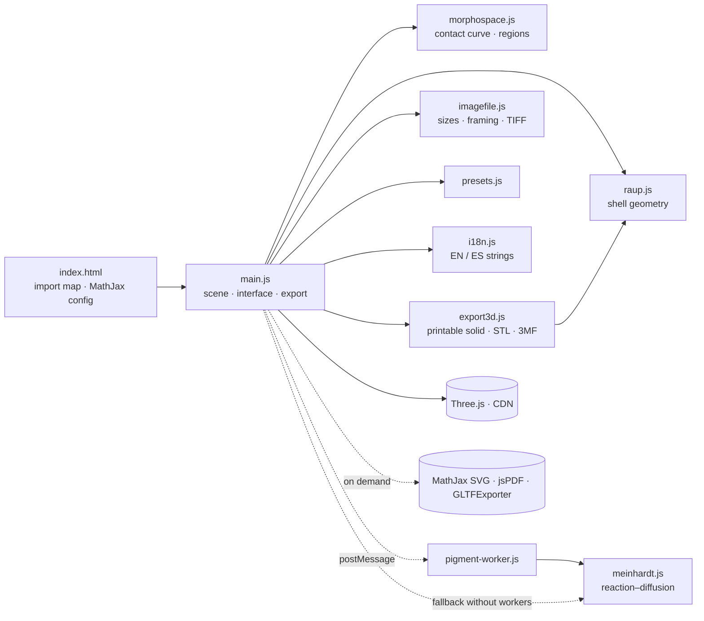
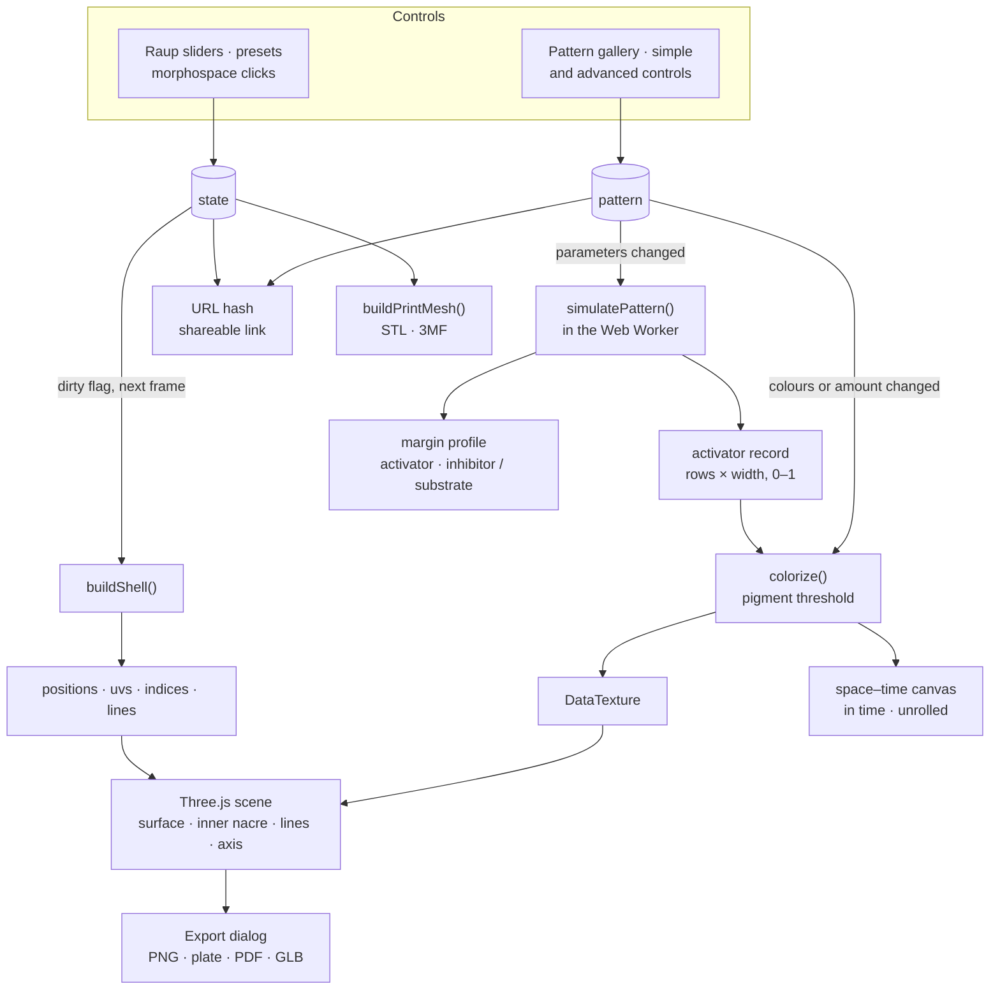

# Architecture

Technical notes for anyone who wants to understand, modify or extend the app. The scientific background and the user guide are in the [README](README.md).

## Technology

The app is a static web page: HTML, CSS and JavaScript ES modules, with no build step and no runtime dependencies to install.

- **Three.js 0.160** (WebGL), loaded from jsDelivr through an *import map* in `index.html`. Add-ons used: `OrbitControls`, `RoomEnvironment`, `LineSegments2` / `LineMaterial`, `Line2` / `LineGeometry`, and `GLTFExporter` (imported on demand).
- **MathJax 3** for the formulas, also from jsDelivr.
- **jsPDF 2.5.1**, loaded from jsDelivr only when a PDF is exported.
- Inter and JetBrains Mono fonts from Google Fonts.
- **Node.js ≥ 20** only for the test suite (`npm test`), which uses the built-in `node:test` runner and has no dependencies.

## Layout

```
index.html            Page, Three.js import map and MathJax configuration
favicon.svg           Icon (an ammonite drawn with a logarithmic spiral)
css/styles.css        Styles: automatic light/dark theme, responsive layout
js/raup.js            Geometry: parametric mesh, UVs, lines, mirror valve, normalisation (pure)
js/meinhardt.js       Pigmentation: Meinhardt's reaction–diffusion models (pure)
js/pigment-worker.js  Web Worker that runs meinhardt.js off the main thread
js/morphospace.js     W–D morphospace: contact curve and occupied regions (pure)
js/export3d.js        3D printing: closed solid with a real wall, binary STL and 3MF (pure)
js/imagefile.js       Image export: fixed sizes, reframing, file names, TIFF encoder (pure)
js/presets.js         Shape and pigmentation presets
js/i18n.js            English and Spanish strings, including the About pages
js/main.js            Scene, interface, views, gizmo, morphospace, formulas, export and URL state
tests/*.test.mjs      Automated tests (node:test)
docs/README.es.md     Spanish translation of the README
docs/introduccion-divulgativa.md  Non-technical introduction in Spanish
docs/images/          Images used by the documentation
```

The modules marked *pure* do not depend on Three.js or the DOM, so they run unchanged in the browser, in the Web Worker and in Node (tests).

## How the program works

### Modules

`main.js` is the only module that touches the DOM and Three.js. The scientific code lives in pure modules that it imports. The pattern simulation runs in a Web Worker so that dragging a slider never freezes the interface. The tests import the pure modules directly.



### Data flow

Every control writes to one of two state objects: `state` (shape and appearance) or `pattern` (pigmentation). The shape is rebuilt at most once per frame. The pattern is simulated only when one of its parameters changes, and simply repainted when only its colours or threshold change.



## Geometry (`js/raup.js`)

`buildShell(params)` is a pure function: it takes the parameters and returns typed arrays ready for the GPU.

1. **θ × φ grid.** θ runs from −2πN to 0 with `segPerTurn` steps per whorl; φ goes around the aperture with `segPhi` steps. Each point follows Raup's equation, with growth factor `g = W^(θ/2π)`.
2. **Mirror valve.** If `mirror` is set, the vertices are duplicated and reflected (y → −y), and the winding of the copy is reversed so its normals still point outwards.
3. **Normalisation.** The shell is centred and scaled so that its largest dimension equals `size`, so the camera never needs to reframe. The complete shell is always used, even while the growth animation shows only part of it, so the scale does not change as it grows.
4. **Triangles.** Each grid cell is split into two triangles, with front faces pointing out of the tube: both the dextral sense and the mirror reflection reverse the winding, and `raup.js` compensates for both.
5. **Lines.** Spiral lines have constant φ; growth lines have constant θ (successive positions of the aperture). Rings are counted from the aperture towards the apex so that the final aperture always has one.
6. **Vertex colours** for the growth bands of the solid mode.
7. **Texture coordinates.** u is the **arc length** along the elliptical aperture (not the angle φ), so the cells of the pigmentation model are evenly spaced along the real margin, also when S ≠ 1. v is uniform in θ (0 at the apex, 1 at the aperture). The column φ = 2π repeats φ = 0 so the texture does not wrap inside the last triangle; `main.js` then averages the normals of that seam so it is invisible under lighting.

It returns `positions`, `colors`, `uvs`, `indices`, `lineIndices`, the position of the coiling axis, the derived values (r_c, a, b), the grid layout and statistics.

### Axis convention

The equation uses a right-handed frame (x, y, z) with z as the coiling axis. Three.js uses Y up, so the mapping is:

```
X = x      Y = z      Z = −y
```

With this mapping, the internal parameter `hand` (+1 dextral, −1 sinistral) equals −ε in the equation. The axes gizmo draws x, y, z of the mathematical frame, not of Three.js.

### Density at high W

In bivalves (W from 10² to 10⁴) almost the whole valve lies in the last fraction of a whorl. To keep the mesh and the growth lines dense enough, `main.js` multiplies `segPerTurn` and `ringsPerTurn` by `max(1, log10 W)`.

## Pigmentation (`js/meinhardt.js`)

`simulatePattern(params, geometry)` is a pure function that returns `{ values, second, state }`: a `rows × width` matrix of activator between 0 and 1 (row 0 is the apex), the second substance (`rows × PROFILE_WIDTH`, relative to its maximum) and a diagnosis `state` (`'pattern'`, `'uniform'` or `'extinct'`).

- **Models.** Meinhardt's activator–inhibitor and activator–substrate models, with saturation κ. The second one supports global control: a signal `c` that follows the mean activity of the margin and raises the basal production when activity drops (`b_a + g / (1 + 40c)`), a simplified version of the mechanism of Meinhardt and Klingler (1987) for the triangles of *Oliva*. In this form it gives oblique lines and V shapes but not the full *Oliva* pattern, so there is no *Oliva* preset.
- **Periodic margin** of up to 256 cells, with a discrete Laplacian (Δx = 1).
- **Integration.** Explicit Euler with time step `dt = min(0.5, 0.4/D_max, 0.4/r_max)`, stable for diffusion. Values are clamped so that extreme parameters cannot overflow.
- **Time.** Every row gets the same time (`T / rows`): a logarithmic spiral traversed at a constant angular rate is growth at a constant relative rate.
- **Cell insertion.** Optional: the margin has `256 · W^(θ/2π)` cells (at least 8). Each new cell duplicates a randomly chosen neighbour, with its own source density. Each row is resampled to the texture width.
- **Noise.** The source density of each cell is `r_a · (1 ± noise)`, drawn from a seeded pseudo-random generator (mulberry32): the same seed always gives the same pattern.
- **Normalisation.** Robust scaling between the 2nd and 99.5th percentiles, ignoring the first quarter of the rows (the initial transient at the apex), so that one isolated peak does not dim the rest. If the activator dies out (`hi < 1e-4`) or the margin stays practically uniform (`(hi − lo)/hi < 5 %`), nothing is rescaled, because amplifying tiny differences would fabricate a false pattern; the interface shows a message instead.

In `main.js` the result is coloured with a **pigmentation threshold**, as in Meinhardt's simulations: pigment where the activator exceeds `1 − amount`, with a short transition (a smoothstep of half-width `PIGMENT_EDGE = 0.12`) so edges are sharp but not jagged. Because cells are resampled linearly to texels before thresholding, edges fall with sub-cell precision. The texture is a 1024 × 2048 `DataTexture`; the same image is drawn on the space–time canvas of the tab. The simulation only runs again when its parameters change or, with cell insertion, when W or N change; changing colours only repaints. It runs in a module Web Worker, or on the main thread if workers are unavailable.

- **Two views of the record.** *In time* draws the record as computed: every whorl gets the same height and every row is normalised to the full width. *Unrolled shell* (`unrolledImage`) draws each row with a width ∝ g = W^(θ/2π) at a height ∝ g − g0, because the distance travelled from the apex is also ∝ g. The result is a straight-sided fan with height/width ratio v·(1 − g0)/(k·P), where k = ln W/2π, v is the advance of the aperture centre per radian and P its perimeter. It is approximate: the outer side of a whorl grows faster than the inner side. `rowToFrac` and `fracToRow` convert between rows and heights for the profile marker.
- **Margin profile.** In the advanced view, clicking or dragging on the space–time record chooses a moment; a canvas plots there the activator, the second substance and the pigment threshold, and shades the pigmented area.
- **Tab flow.** Entering the pigment tab switches to solid mode (no lines), but the shell keeps its plain colour: the user picks the pattern. A gallery shows the solid-colour option and each preset with a real thumbnail, computed once in a separate worker.
- **Simple and advanced controls.** The simple controls are real quantities of the model, not hidden multipliers: *pattern size* sets the number of margin cells (`nMax = 256 / size`), *growth time* is `T`, *irregularity* is `noise`, and *pigment amount* only shifts the colouring threshold (without simulating again). The advanced view adds the model, all its constants and cell insertion. Constants use logarithmic sliders (`log: true` in `createParam`); with `zero: true` the leftmost position is exactly 0. Dragging a logarithmic slider rounds the value to what is displayed (two significant figures), so the visible value is always the real one and a pattern can be reproduced by typing its numbers. Changing the model loads its default constants (`MODEL_DEFAULTS` in `presets.js`), keeping colours, size and amount: the *Nautilus* preset for the activator–inhibitor model, and an excitable set without saturation that draws travelling waves for the activator–substrate model.
- **Stale computations.** If a new computation arrives while the worker is busy, the worker is terminated and a new one is started: when dragging a slider only the last value matters.
- **Outside and inside.** The outside (`FrontSide`) carries the colour or the pattern; the inside (`BackSide`) uses a light `MeshPhysicalMaterial` with some iridescence, like nacre.
- **Equations.** The *Equation* panel has two views, Raup and Meinhardt. The Meinhardt view shows the equations of the active model and the same equations with the current values, omitting zero terms.

## Morphospace (`js/morphospace.js`)

- **Contact curve.** For T = 0 the inner edge of a whorl lies at distance g·D from the axis and the outer edge of the previous whorl at g/W, so they touch exactly when D = 1/W, for any S. The tests check this numerically with `buildShell`.
- **Regions.** Polygons in (log W, D) that start at D = 0. Gastropods and bivalves are half-ellipses; ammonoids and nautiloids are a band below D = 1/W (whorls in contact or overlapping). They are approximate and do not reproduce published numerical outlines.
- **Section of the cube.** The plane is a section at the current T, so each region has `tOk(T)`; regions that fail it are drawn faded.
- **Interaction.** In `main.js`, the group names are links (`labelBoxes`) that load the typical preset of the group; clicking anywhere else changes only W and D. The W axis can span 1–10 or 1–10⁴ (`MORPHO.logMax`).

## Rendering (`js/main.js`)

- **Modes.** *Lines* draws only the lines; *Solid* the surface with `MeshStandardMaterial`, a directional light with soft shadows, a hemisphere light and an environment map (`RoomEnvironment`); *Both* draws both.
- **Lines with a width.** Native WebGL lines are always 1 px wide, so `LineSegments2` with `LineMaterial` is used. The coiling axis is a dashed `Line2` whose width (`state.axisWidth`, 1 px by default) can be changed.
- **Hidden-line removal.** In *Lines* mode the surface is drawn with `colorWrite: false`: it only writes to the depth buffer and hides the back lines. A `polygonOffset` pushes the surface back slightly so the visible lines do not flicker.
- **Axes gizmo.** A second scene with an orthographic camera that copies the orientation of the main camera and is drawn in a corner with `setScissor` / `setViewport`.
- **Standard views.** The transition interpolates the camera position in spherical coordinates (azimuth and elevation separately), so the orientation stays continuous even at the apical and umbilical views, which look along the vertical axis. Pending `OrbitControls` inertia is consumed first so the camera does not spin afterwards.
- **Portrait screens.** On mobile the vertical field of view is widened to keep the horizontal framing.
- **Rebuilds.** Any control marks the mesh as dirty and it is rebuilt once on the next frame, even if several values changed.

## Interface

- **Parameters.** `createParam` builds each control (synchronised slider and number box). W has a linear (1–10) and a logarithmic (1–10⁴) scale, and switches to the logarithmic one when its value exceeds 10.
- **Overlaid charts.** The *Graphs* menu of the viewer toolbar (a `<details>` element) toggles two panels on the 3D view, off by default: the morphospace (interactive) and the margin profile, with a slider that chooses the moment (`profileRow`, shared with the advanced view). `drawMorphoOn(canvas)` and `drawProfileOn(canvas, row)` draw on any canvas, also off-screen for the PDF. *Hide info* mode hides them too.
- **Formulas.** MathJax is configured with `startup.typeset: false`; each formula is typeset when its panel becomes visible, through a promise queue so two typesetting jobs never overlap.
- **Languages.** `js/i18n.js` holds every string. In the HTML, the `data-i18n`, `data-i18n-html` and `data-i18n-title` attributes mark what to translate; everything else (parameters, presets, morphospace, charts) is translated from `main.js`. The page opens in English, or in the language chosen on a previous visit. The choice is stored in `localStorage` through a small `storage` wrapper that does nothing if storage is unavailable.
- **State in the URL.** The current shell is stored in the hash (`#W=2.4&D=0.08&T=1.6&S=1&N=4.5&h=1&v=0&m=lines`) with `history.replaceState`, so copying the address shares the shell. With a pattern applied, `pg=1` and its parameters are added (`pm`, `pDa`, `pD2`, …, `ps` for the seed, `pi` for insertion and `pcb`/`pcp` for the colours).
- **Tabs.** The sidebar has two tabs (Shape and Pigment) and the About dialog three pages (Raup, Meinhardt and Credits). The pages contain only theory and credits; technical details live only in this document. Each page is typeset with MathJax the first time it is shown.
- **Welcome guide** (`#welcome`). Opens on the first visit, unless the page was opened from a shared link (a hash with shape or pattern), always when the address contains `?guide`, and again from the *Guide* button; closing it stores `coiling-shells.welcome` in `localStorage`. It has its own small Three.js scene (`buildWelcome`, built the first time it opens) with a garden snail generated by `buildShell` in a plain shell colour, `OrbitControls` for rotation which turn it when dragged. The labels of the parts (`shellAnchors`) are anchored to points of the generated mesh: apex, spire, suture, body whorl, aperture (centre of the last ring) and coiling axis. The suture is computed exactly: two rings one turn apart lie in the same meridian plane, and the crossing of their outlines farther from the axis is the suture seen from outside. The umbilicus is not labelled: in the garden snail it is a tiny opening only visible from below. Parts that run along a whorl have several candidate points; every few frames each label moves to the closest candidate that is not hidden, tested by ray casting against a coarse copy of the shell, and labels with no visible candidate are faded. Labels are spread vertically on each side so they never overlap. The scene only renders while the guide is open, and the main viewer pauses meanwhile.
- **Fullscreen and hide info.** Fullscreen uses the Fullscreen API on the viewer container. *Hide info* adds the `clean` class to `<body>`, which hides everything except the canvas and a button to come back.
- **Pointer capture.** `capturePointer` wraps `setPointerCapture`, which throws if the pointer is no longer active (e.g. a cancelled touch).

## Export

Everything happens in a dialog (`#exportDlg`) in the browser, with no server.

- **What is exported follows what is shown.** `colourShown()` is false in *Lines* mode: then the PDF leaves out the pigmentation page and Meinhardt's equations, and the GLB contains only the lines. `withExportAxis` shows or hides the coiling axis according to `#exAxis` while the image, the plate or the PDF are rendered.
- **Image formats and names.** Every image (current view, plate, space–time record) goes through `downloadImage` with the format chosen in its own card: PNG or JPEG with `toBlob`, or as TIFF with `encodeTIFF` (`js/imagefile.js`: RGB, 8 bits, Deflate with horizontal predictor, strips of about 256 KB, 300 dpi). The optional name typed in `#exName` replaces the preset name in the PDF title and the 3D files, and `slugify` turns it into the file name.
- **Image of the current view** (`renderViewImage`). The size is either the screen view multiplied (×1, ×2, ×4), a fixed size (`FIXED_SIZES`: 16:9, 16:10, 21:9, 4:3, 1:1 and phone formats, or the device screen) or a custom one, always within 8192 px. `fitFrame` keeps the whole region seen on screen: a wider image keeps the vertical field of view, a taller one widens it to keep the horizontal one. The image is drawn in tiles of up to 2048 px with `camera.setViewOffset` and assembled on a 2D canvas, so it never depends on how large a drawing buffer the browser grants; line widths are scaled with the image through `LineMaterial.resolution`. Each tile is copied in the same task as its render, so `preserveDrawingBuffer` is not needed.
- **Plate of standard views** (`renderPlate`). Six views (apertural, dorsal, apical, umbilical, profile and 3/4) with an `OrthographicCamera`. Each view is framed by projecting the vertices onto the camera plane. In the apical and umbilical views the `up` vector puts the aperture at the bottom. At a fixed size, `plateLayout` (`js/imagefile.js`) picks the grid (3 × 2, 2 × 3, 6 × 1 or 1 × 6) that gives the largest views and centres it. During rendering the ground is hidden and the key light is moved to the upper left of the viewer; everything is restored afterwards.
- **PDF** (`exportPDF`). The background (`#exPdfBg`) is white, the current colour behind the shell images only, or the current colour on the whole sheet; `pdfPalette` then switches text, rules, graphs and equations to light ink on dark colours. Page 1: plate, parameters, derived values, morphospace (drawn off-screen with the sheet palette) and a link with the current hash. Page 2, if a pattern is shown: space–time record with labelled axes and the profile moment marked, two pigmented views, the margin profile and the constants. Optional equations page (`#exEq`): `generalTeX(view)` and `liveTeX(view)` are typeset by MathJax with SVG output inside a separate iframe (the page uses CHTML output, which cannot be rasterised) and converted to PNG at about 300 dpi. The standard PDF fonts only cover Latin-1, so `pdfSafe` replaces arrows, dashes and Greek letters.
- **3D printing** (`js/export3d.js`). `buildPrintMesh` rebuilds the shell at print resolution (at most 160 segments per whorl and 900 rows in total, 96 around the aperture) and turns it into a closed solid:
  - the inner wall is offset inwards along the normal, with the thickness capped at 45 % of the smallest radius of each ring (the tube is solid near the apex);
  - rings close the aperture and the apex;
  - at the end rings the wall is offset within the plane of the ring (Newell normal), so the lip of the aperture and the cap at the apex are flat;
  - because the tube widens, the inner wall is clipped against the planes of the ends within 60° of each end (only there: those planes contain the axis and cut through the other whorls);
  - faces are consistently oriented by construction, and the global orientation is chosen from the sign of the volume;
  - finally the mesh is rescaled so its largest dimension is exactly the requested size (with very thick walls on strongly curved valves the inner wall can protrude by up to 0.6 %).

  Coordinates are in millimetres, with z = coiling axis (apex up) and the base at z = 0. The 3MF writer is a minimal hand-written ZIP, compressed with `CompressionStream('deflate-raw')` when available. Raup's whorls overlap one another; slicers merge overlapping volumes.
- **GLB** (`GLTFExporter`). Exports the surface with its material (colour, bands or pattern texture) as double-sided. Vertex colours are included only when used, because in glTF they always multiply the texture. In *Lines* and *Both* modes the lines are added as `LineSegments`.
- **Space–time record.** The pattern canvas, in the chosen image format.

## Tests

```bash
npm test        # node --test, Node.js ≥ 20, no dependencies
```

| File | What it checks |
|---|---|
| `tests/raup.test.mjs` | Grid sizes and index ranges; normalisation to the requested size; mirror valve; dextral/sinistral symmetry; arc-length u coordinate; **whorls touch exactly at D = 1/W for any S** (measured on the mesh); growth animation |
| `tests/meinhardt.test.mjs` | Seeded generator; every pattern preset forms a pattern with values in [0, 1]; same seed, same pattern; `extinct` and `uniform` diagnoses; bands are stable in time while flames oscillate; the default constants of each model form a pattern, and those of the activator–substrate model draw travelling waves |
| `tests/morphospace.test.mjs` | Contact curve; each shape preset lies in the region of its group; freely coiled forms lie outside; regions point to existing presets and state their range of T |
| `tests/export3d.test.mjs` | Every preset and extreme parameters (W 1.01 and 10⁴, D 0.9, T 10, S 0.5 and 2, N 0.25 and 20, mirror valve; walls 0.4 and 6 mm; sizes 30 and 250 mm) give closed, consistently oriented, outward-facing solids of the exact size with the base at z = 0; STL structure; 3MF package (ZIP entries, units, vertex and triangle counts) |
| `tests/imagefile.test.mjs` | TIFF round trip (decoded with zlib, predictor undone) for several sizes and strips; compression of a flat background; reframing at wider and taller aspect ratios; layout of the plate in landscape, portrait and strip formats; file names from free text; fixed sizes within the limit |
| `tests/i18n.test.mjs` | English and Spanish have the same keys; every key and element id used in the HTML and `main.js` exists; no control characters in the strings |

The tests run on every push and pull request through GitHub Actions (`.github/workflows/tests.yml`).

## Running locally

ES modules do not load from `file://`, so serve the folder:

```bash
python3 -m http.server 8000   # or: npm run serve
# open http://localhost:8000
```

## Deployment

GitHub Pages serves the `main` branch of this repository at https://albertogonzalezcasarrubios.github.io/coiling-shells/. All paths are relative, so the app also works from any subfolder. The previous address (`aplicaciones-varias/shells-morphology/`) redirects here and keeps the shared shell in the hash.

The icon is linked as `favicon.svg?v=N`; if the drawing changes, increase the number so browsers do not keep the old one in their cache.

## Third-party licences

Three.js (MIT), MathJax (Apache-2.0) and jsPDF (MIT) are loaded from a CDN and keep their own licences.
