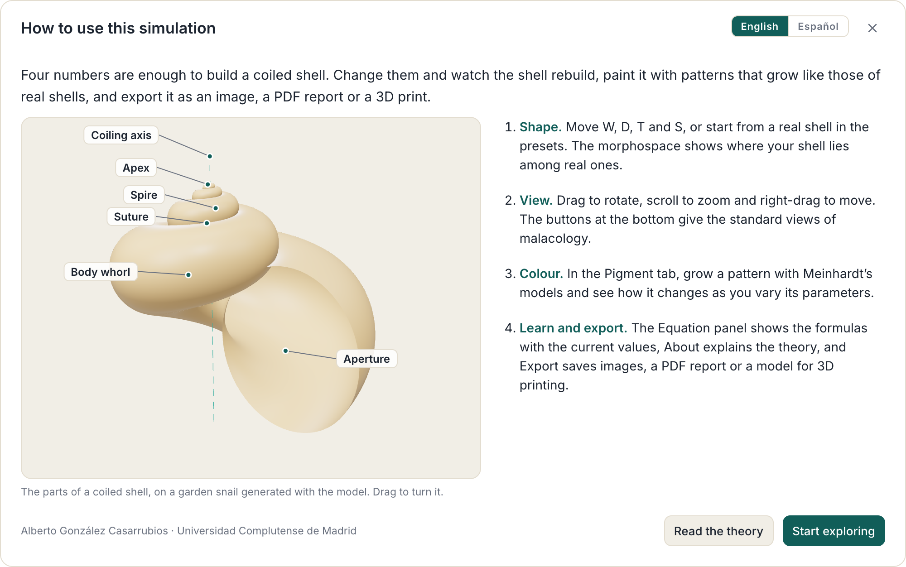
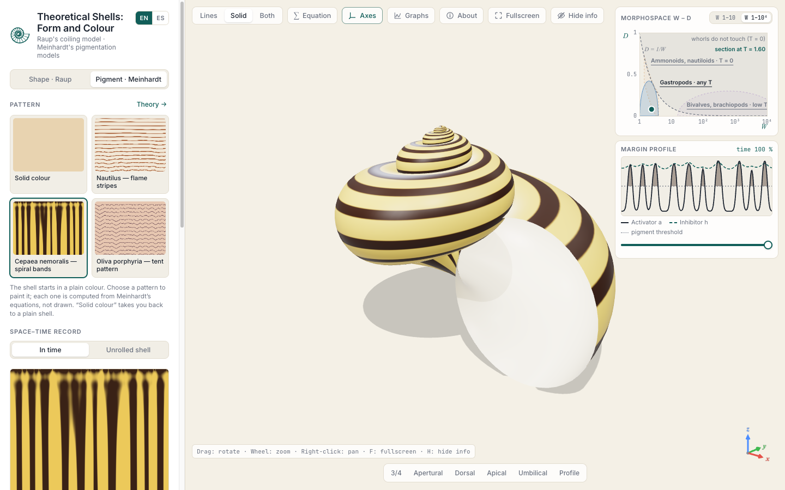
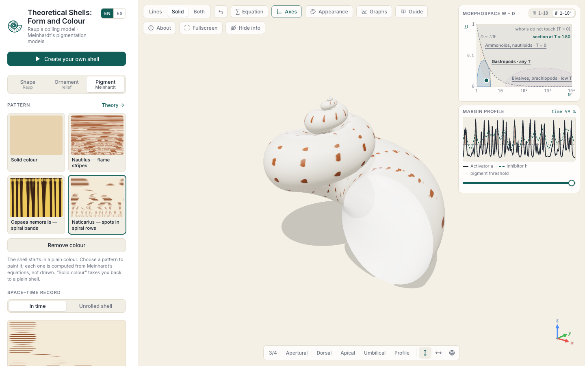
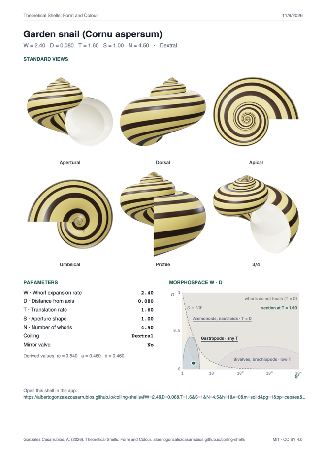
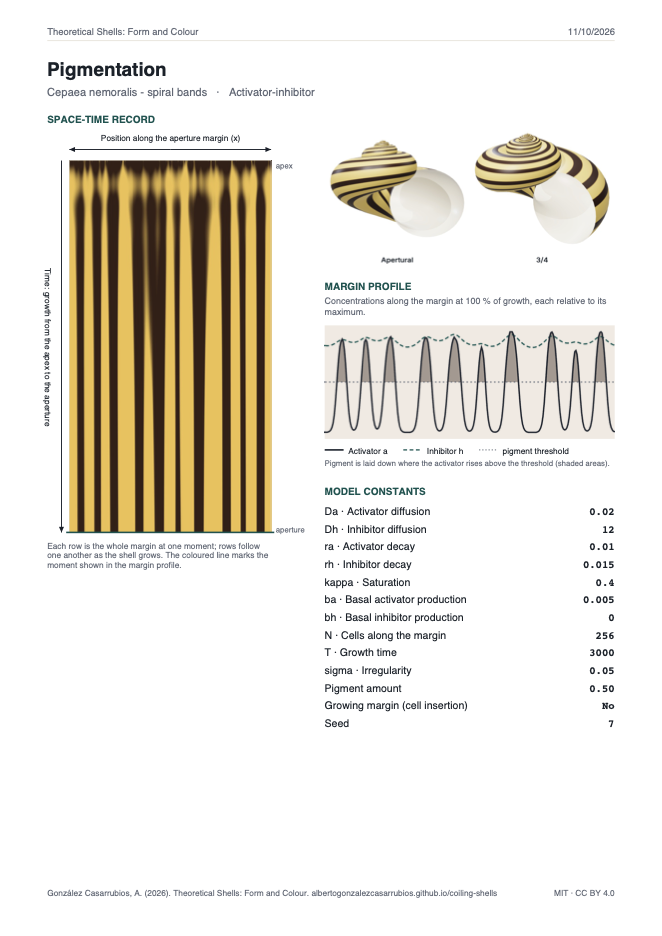
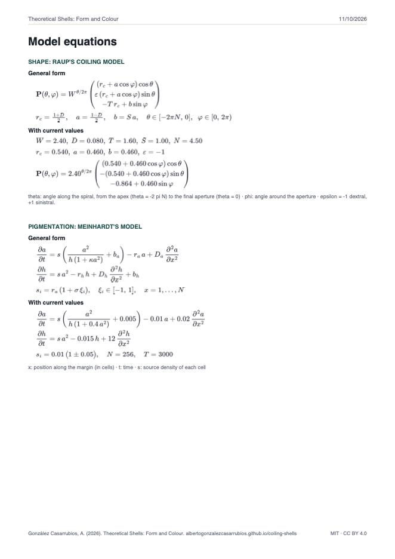
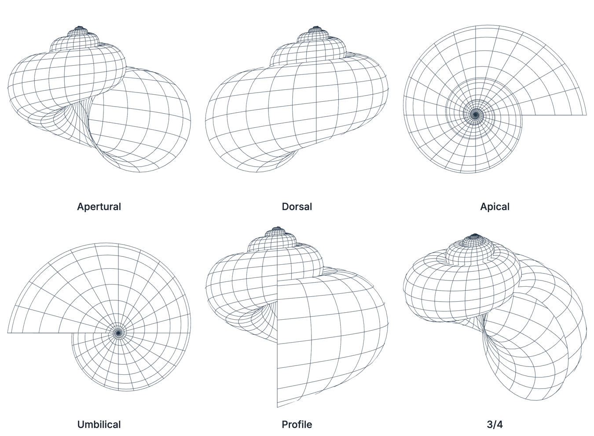

> *"The basic form of many coiled gastropod shells can be defined by four parameters. A digital computer with automatic plotting equipment can be used to make graphical reconstructions of a shell from any given values of the four parameters."*
>
> — David M. Raup, *Science* (1962)

# Theoretical Shells: Form and Colour

[](https://github.com/AlbertoGonzalezCasarrubios/coiling-shells/actions/workflows/tests.yml)
[](LICENSE)
[](LICENSE-CONTENT.md)
[](https://albertogonzalezcasarrubios.github.io/coiling-shells/)

**English** · [Español](docs/README.es.md)

An interactive 3D explorer of the **theoretical morphology of coiled shells**. The shape comes from David M. Raup's shell-coiling model (1962, 1966) and, optionally, the colour pattern from Hans Meinhardt's reaction–diffusion models of shell pigmentation. It runs entirely in the browser, with no installation, in English and Spanish.

**▶ Open the app: https://albertogonzalezcasarrubios.github.io/coiling-shells/**

On the first visit, a short guide shows the parts of a coiled shell on an interactive 3D model and explains how the app works; the *Guide* button opens it again, and adding `?guide` to the address always shows it. The app opens in English; Spanish can be chosen in the guide or with the EN / ES button, and the choice is remembered.



After closing the guide, the app shows a garden snail drawn with lines, ready to explore:



## What it is for

- **Exploring Raup's model:** change W, D, T and S and the shell rebuilds instantly, with the equation shown both in general form and with the current values.
- **Exploring the morphospace:** place the shell in Raup's morphospace and see which regions real shells occupy and which stay empty.
- **Growing a pigmentation pattern:** apply one of Meinhardt's models to the shell and watch the activator and the inhibitor (or substrate) that produce it.
- **Taking the result off the screen:** export images, a plate of the standard malacological views, a PDF report with all the values and equations, 3D models, or a closed solid ready for a 3D printer.
- **Teaching:** the *About* dialog explains both models in detail. The app is suited to palaeontology, evolutionary biology and pattern formation courses, and to anyone curious about why shells look the way they do.

## How it works

### Shape: Raup's coiling model

A generating curve, here an ellipse that represents the aperture, is swept around the coiling axis z. After one full revolution every linear dimension has been multiplied by W:

```
P(θ, φ) = W^(θ/2π) · ( (r_c + a·cos φ)·cos θ,
                      ε·(r_c + a·cos φ)·sin θ,
                        −T·r_c + b·sin φ )

r_c = (1 + D)/2,   a = (1 − D)/2,   b = S·a,   θ ∈ [−2πN, 0],   φ ∈ [0, 2π)
```

| Parameter | Meaning | Effect |
|---|---|---|
| **W** | Whorl expansion rate | Low values give many tight whorls; very high values (10²–10⁴) give bivalves |
| **D** | Distance of the aperture from the axis | D = 0 closes the umbilicus; larger values open it until the whorls separate |
| **T** | Translation rate along the axis | T = 0 gives planispiral shells (nautilus, ammonites); high values give tall spires |
| **S** | Shape of the aperture | Ratio between its axial and radial semi-axes |

The number of whorls N and the coiling direction (dextral, ε = −1, or sinistral, ε = +1) complete the shell. A mirror valve turns a single valve into an equivalve bivalve. Presets cover real forms: garden snail, *Turritella*, *Trochus*, *Planorbis*, *Physa*, *Peringia*, *Nautilus*, an evolute ammonite and a clam. The shell can be drawn with lines, as a solid or both, seen from the six standard views of malacology, and animated as it grows.

### Morphospace

The W–D panel shows Raup's morphospace with the contact curve D = 1/W, where successive whorls of a planispiral shell just touch, and the approximate regions occupied by gastropods, ammonoids and nautiloids, and bivalves and brachiopods.

The plane is a **section of Raup's W–D–T cube at the current T**. The groups differ mainly in T, so the regions of groups that do not exist at that T are faded. Clicking a group's name loads a typical shell of that group. Clicking anywhere else moves the shell to that point, changing only W and D. The W axis can span 1–10, to see snails and cephalopods in detail, or 1–10⁴, to include the bivalves. The morphospace can also be shown on top of the 3D view.

### Pigmentation: Meinhardt's models

A mollusc only adds pigment at the growing margin, so a shell pattern is a **time record of a one-dimensional process**: space runs along the margin and time along the direction of growth. The app simulates the margin with Meinhardt's reaction–diffusion models and wraps the resulting space–time record onto Raup's surface, as Fowler, Meinhardt and Prusinkiewicz (1992) did.



- **Activator–inhibitor model.** A self-enhancing activator and a fast, far-reaching inhibitor give stable peaks, which draw bands along the spiral (*Cepaea nemoralis*). If the inhibitor outlives the activator, the margin oscillates and draws stripes parallel to the growth lines (the flames of *Nautilus*).

  ```
  ∂a/∂t = s·(a²/(h·(1 + κa²)) + b_a) − r_a·a + D_a·∂²a/∂x²
  ∂h/∂t = s·a² − r_h·h + D_h·∂²h/∂x² + b_h
  ```

- **Activator–substrate model.** The activator consumes a substrate that recovers slowly, so activation travels as waves that draw oblique lines and annihilate when they meet. Meinhardt and Klingler (1987) explained the triangles of *Oliva porphyria* by adding a signal shared by the whole margin that starts new waves when activity drops. The app includes a simplified version of that global control, which gives oblique lines and V shapes but not the full *Oliva* pattern, so it is available in the advanced controls and not as a species preset.

Two presets reproduce real pattern types: the flame stripes of *Nautilus* and the spiral bands of *Cepaea nemoralis*.

**Simple controls** set real quantities of the model: the number of cells along the margin, the growth time, the irregularity between cells and the pigment threshold. A seed chooses the random differences between cells. **Advanced controls** expose every constant of the equations, the choice of model and the insertion of new cells as the margin grows. The space–time record can be seen in time, which is Meinhardt's diagram, or unrolled with the true proportions of the shell. A **margin profile** plots the activator and the inhibitor or substrate at any moment of growth. If a set of values forms no pattern, the app says so instead of showing an empty shell.

## Exporting

The **Export…** button at the bottom of the sidebar opens a dialog with every export option. You can give your shell a name, which becomes the title of the PDF and the name of the downloaded files, and choose the image format (PNG, JPG or TIFF). A single checkbox adds the coiling axis to the images, the plate and the PDF, even if it is hidden in the 3D view. Exports follow the render mode: in *Lines* mode they contain no colour.

| Output | Format | Content |
|---|---|---|
| Current view | PNG, JPG, TIFF | Exactly what the 3D view shows, at one, two or four times the screen resolution, or at a fixed size such as 16:9 4K, 21:9 or a phone screen, for wallpapers. At another aspect ratio the framing widens or narrows so the shell is never cut |
| Plate of standard views | PNG, JPG, TIFF | Apertural, dorsal, apical, umbilical, profile and 3/4 views, in orthographic projection, labelled, on a white or the current background. Also at the same fixed sizes as the current view: the views are arranged in 3 × 2, 2 × 3 or a single row or column to fill the format |
| Report | PDF (A4) | Plate, parameter values, position in the morphospace and a link that reopens the same shell, on white, with the shell images on the current background colour, or with the whole sheet in that colour. With a pattern, a page with the space–time record, the margin profile and the model constants. Optionally, a page with the full equations in general form and with the current values |
| 3D printing | STL, 3MF | A closed, watertight solid with a real wall thickness, in millimetres, with the apex up and the base on the print bed. You choose the size and the wall thickness |
| 3D model | GLB (glTF) | The surface with its colour and pattern, for 3D viewers, Blender or augmented reality |
| Pattern | PNG, JPG, TIFF | The space–time record of the pigmentation |

The page address also stores the current shell and pattern, so copying the link shares exactly what is on screen.

**Example report** (garden snail with the *Cepaea nemoralis* pattern, three pages):

<p>
  
  
  
</p>

**Plate of standard views** (*Turritella*, transparent lines and coiling axis):



## Running locally

The app is a static site with no build step. ES modules do not load from `file://`, so serve the folder:

```bash
git clone https://github.com/AlbertoGonzalezCasarrubios/coiling-shells.git
cd coiling-shells
python3 -m http.server 8000      # or: npm run serve
# open http://localhost:8000
```

Three.js, MathJax and jsPDF are loaded from a CDN, so an internet connection is needed.

**Keyboard:** `F` fullscreen · `H` hide or show all panels · `Esc` leave fullscreen or show the panels again.

## Tests

```bash
npm test          # Node.js ≥ 20, no dependencies
```

The tests check, among other things, that:

- planispiral whorls touch exactly at D = 1/W for any aperture shape;
- pattern cells are evenly spaced along elliptical apertures;
- every pigmentation preset forms a pattern, and the same seed always gives the same pattern;
- each shape preset lies in the morphospace region of its group;
- the printable solid is closed, faces outwards and has exactly the requested size. This is checked for every preset and for extreme parameters;
- STL and 3MF files are well formed;
- the English and Spanish texts are complete.

They run on every push through GitHub Actions. [ARCHITECTURE.md](ARCHITECTURE.md) describes how the program is organised and what each test covers.

## Limitations

These are minimal models:

- **Raup's model** assumes that the aperture keeps the same shape and orientation throughout life (no allometry), and it has no ornament, internal structures or hinge.
- **The morphospace regions** are approximate outlines, not fits to measured data.
- **Meinhardt's models** treat the margin as a closed ring of equivalent cells, and the molecules involved have not been identified in any mollusc.
- **The presets** reproduce the type of form or pattern of each species, not particular specimens.

## Citation

> González Casarrubios, A. (2026). *Theoretical Shells: Form and Colour* (version 1.0.0) [Computer software]. https://github.com/AlbertoGonzalezCasarrubios/coiling-shells

Citation metadata are in [CITATION.cff](CITATION.cff); GitHub shows them under *Cite this repository*.

## License

- **Source code:** [MIT License](LICENSE).
- **Texts, explanations and images:** [Creative Commons Attribution 4.0 International (CC BY 4.0)](LICENSE-CONTENT.md).
- **Third-party libraries:** Three.js (MIT), MathJax (Apache-2.0) and jsPDF (MIT) are loaded from a CDN under their own licences.

## Contact

Alberto González Casarrubios, Universidad Complutense de Madrid · [albert23@ucm.es](mailto:albert23@ucm.es). Bug reports and suggestions are welcome as [issues](https://github.com/AlbertoGonzalezCasarrubios/coiling-shells/issues).

## References

- Ermentrout, B., Campbell, J., & Oster, G. (1986). A model for shell patterns based on neural activity. *The Veliger*, 28, 369–388.
- Fowler, D. R., Meinhardt, H., & Prusinkiewicz, P. (1992). Modeling seashells. *Computer Graphics (SIGGRAPH '92)*, 26(2), 379–387.
- Gierer, A., & Meinhardt, H. (1972). A theory of biological pattern formation. *Kybernetik*, 12, 30–39.
- Meinhardt, H. (2009). *The Algorithmic Beauty of Sea Shells* (4th ed.). Springer.
- Meinhardt, H., & Klingler, M. (1987). A model for pattern formation on the shells of molluscs. *Journal of Theoretical Biology*, 126, 63–89.
- Raup, D. M. (1961). The geometry of coiling in gastropods. *Proceedings of the National Academy of Sciences*, 47, 602–609.
- Raup, D. M. (1962). Computer as aid in describing form in gastropod shells. *Science*, 138, 150–152.
- Raup, D. M. (1966). Geometric analysis of shell coiling: general problems. *Journal of Paleontology*, 40, 1178–1190.
- Raup, D. M. (1967). Geometric analysis of shell coiling: coiling in ammonoids. *Journal of Paleontology*, 41, 43–65.
- Raup, D. M., & Michelson, A. (1965). Theoretical morphology of the coiled shell. *Science*, 147, 1294–1295.
- Turing, A. M. (1952). The chemical basis of morphogenesis. *Philosophical Transactions of the Royal Society B*, 237, 37–72.
