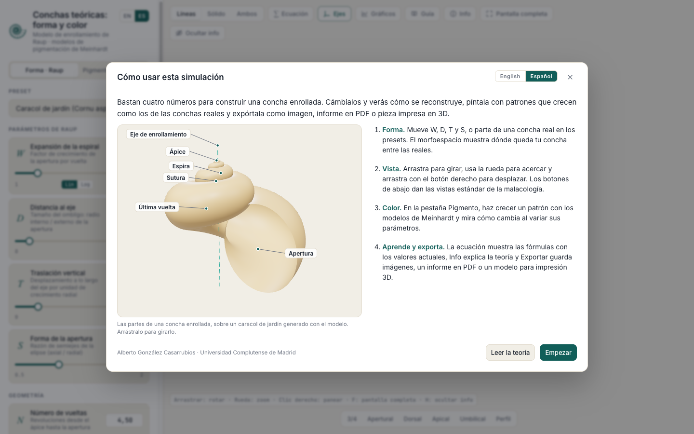
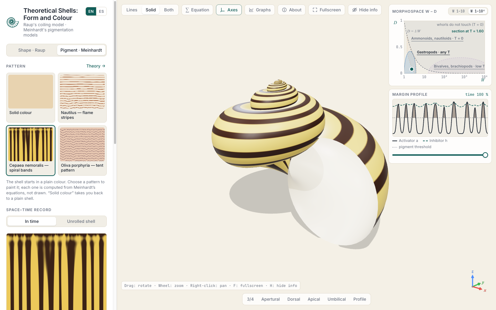
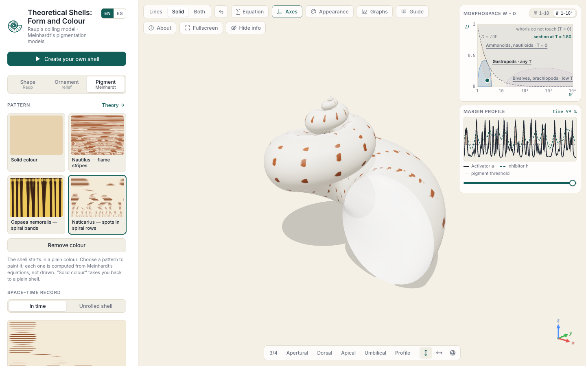
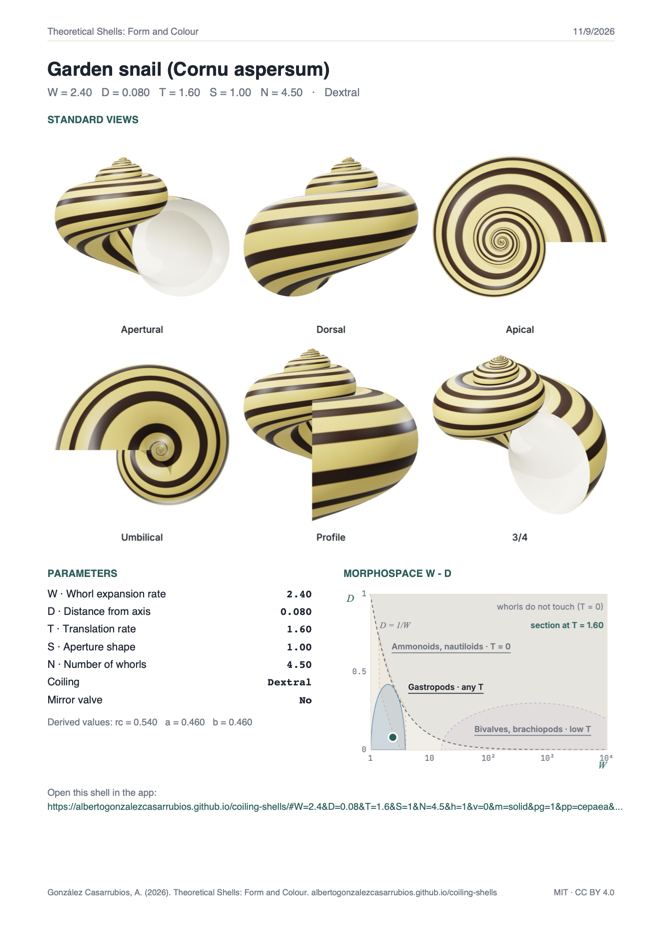
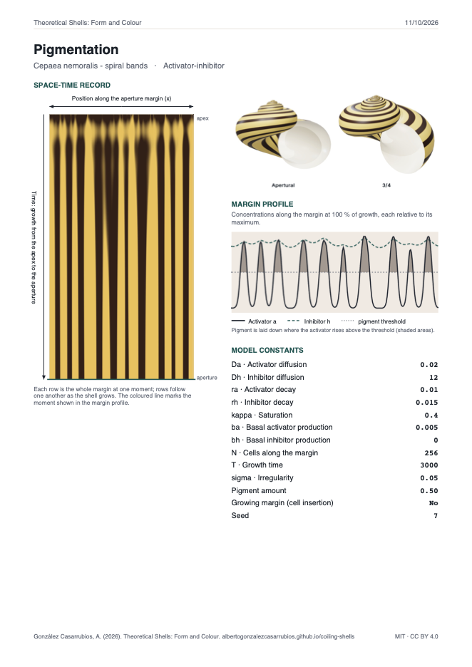
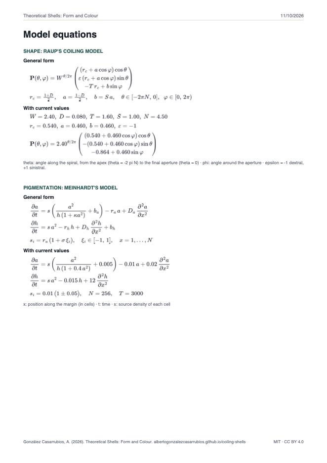
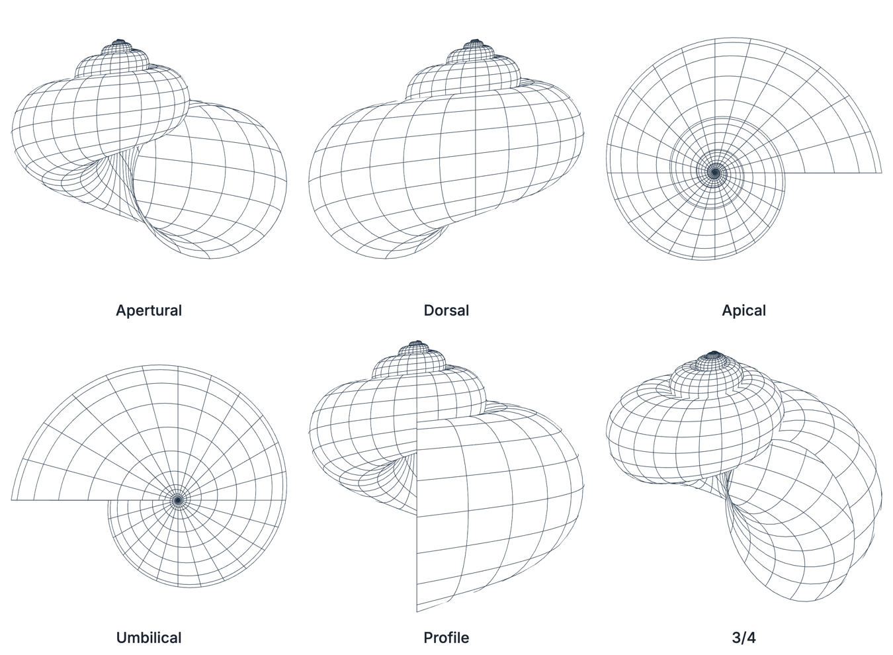

> *"The basic form of many coiled gastropod shells can be defined by four parameters. A digital computer with automatic plotting equipment can be used to make graphical reconstructions of a shell from any given values of the four parameters."*
>
> *«La forma básica de muchas conchas enrolladas de gasterópodos puede definirse mediante cuatro parámetros. Un ordenador digital con un trazador automático puede usarse para reconstruir gráficamente una concha a partir de cualquier valor de esos cuatro parámetros.»*
>
> — David M. Raup, *Science* (1962)

# Conchas teóricas: forma y color

[](https://github.com/AlbertoGonzalezCasarrubios/coiling-shells/actions/workflows/tests.yml)
[](../LICENSE)
[](../LICENSE-CONTENT.md)
[](https://albertogonzalezcasarrubios.github.io/coiling-shells/)

[English](../README.md) · **Español** · [Introducción divulgativa](introduccion-divulgativa.md)

Un explorador 3D interactivo de la **morfología teórica de las conchas enrolladas**. La forma procede del modelo de enrollamiento de conchas de David M. Raup (1962, 1966) y, de forma opcional, el patrón de color procede de los modelos de reacción-difusión de Hans Meinhardt para la pigmentación de las conchas. Funciona por completo en el navegador, sin instalación, en inglés y en español.

**▶ Abrir la app: https://albertogonzalezcasarrubios.github.io/coiling-shells/**

En la primera visita, una guía breve muestra las partes de una concha enrollada sobre un modelo 3D interactivo y explica cómo funciona la app; el botón *Guía* la vuelve a abrir, y añadir `?guide` a la dirección la muestra siempre. La app se abre en inglés; el español se elige en la guía o con el botón EN / ES, y la elección se recuerda.



Al cerrar la guía, la app muestra un caracol de jardín dibujado con líneas, listo para explorar:



## Para qué sirve

- **Explorar el modelo de Raup:** cambia W, D, T y S y la concha se reconstruye al instante, con la ecuación en forma general y con los valores actuales.
- **Explorar el morfoespacio:** sitúa la concha en el morfoespacio de Raup y mira qué regiones ocupan las conchas reales y cuáles quedan vacías.
- **Hacer crecer un patrón de pigmentación:** aplica uno de los modelos de Meinhardt a la concha y observa el activador y el inhibidor (o el sustrato) que lo producen.
- **Sacar el resultado de la pantalla:** exporta imágenes, una lámina con las vistas estándar de la malacología, un informe en PDF con todos los valores y ecuaciones, modelos 3D o un sólido cerrado listo para una impresora 3D.
- **Enseñar:** el diálogo *About* explica los dos modelos en detalle. La app está pensada para asignaturas de paleontología, biología evolutiva y formación de patrones, y para cualquiera que tenga curiosidad por saber por qué las conchas tienen el aspecto que tienen.

## Cómo funciona

### Forma: el modelo de enrollamiento de Raup

Una curva generadora, aquí una elipse que representa la apertura, gira alrededor del eje de enrollamiento z. Tras una revolución completa, todas las dimensiones lineales se han multiplicado por W:

```
P(θ, φ) = W^(θ/2π) · ( (r_c + a·cos φ)·cos θ,
                      ε·(r_c + a·cos φ)·sin θ,
                        −T·r_c + b·sin φ )

r_c = (1 + D)/2,   a = (1 − D)/2,   b = S·a,   θ ∈ [−2πN, 0],   φ ∈ [0, 2π)
```

| Parámetro | Significado | Efecto |
|---|---|---|
| **W** | Tasa de expansión de la espiral | Los valores bajos dan muchas vueltas apretadas; los valores muy altos (10²–10⁴) dan bivalvos |
| **D** | Distancia de la apertura al eje | D = 0 cierra el ombligo; los valores mayores lo abren hasta que las vueltas se separan |
| **T** | Tasa de traslación a lo largo del eje | T = 0 da conchas planispirales (nautilos, ammonites); los valores altos dan espiras altas |
| **S** | Forma de la apertura | Razón entre sus semiejes axial y radial |

El número de vueltas N y el sentido de enrollamiento (dextral, ε = −1, o sinistral, ε = +1) completan la concha. Una valva especular convierte una sola valva en un bivalvo equivalvo. Los presets cubren formas reales: caracol de jardín, *Turritella*, *Trochus*, *Planorbis*, *Physa*, *Peringia*, *Nautilus*, un ammonite evoluto y una almeja. La concha se puede dibujar con líneas, como sólido o de las dos formas, verse desde las seis vistas estándar de la malacología y animarse mientras crece. El visor puede mantener vertical el eje de enrollamiento, tumbarlo para ver de frente las conchas planispirales o dejarte girar la concha libremente.

Una pestaña de *Ornamento* añade relieve a la superficie: costillas axiales y várices, cordones espirales, un dibujo reticulado, nódulos, una quilla y espinas, con ejemplos que cargan a la vez la forma y el relieve de conchas reales. El relieve es descriptivo, en la línea de Fowler, Meinhardt y Prusinkiewicz (1992) y Cortie (1993). El espaciado de los cordones espirales tiene además un modelo mecánico, según Moulton, Goriely y Chirat (2012): el borde del manto se pandea en ondas cuando crece más deprisa que la concha, y la app muestra qué número de ondas aparece primero y lo hace crecer en la concha.

### Morfoespacio

El panel W–D muestra el morfoespacio de Raup con la curva de contacto D = 1/W, donde las vueltas sucesivas de una concha planispiral justo se tocan, y las regiones aproximadas que ocupan los gasterópodos, los ammonoideos y nautiloideos, y los bivalvos y braquiópodos.

El plano es un **corte del cubo W–D–T de Raup con el T actual**. Los grupos se distinguen sobre todo por T, así que las regiones de los grupos que no existen con ese T aparecen atenuadas. Al pinchar en el nombre de un grupo se carga una concha típica de ese grupo. Al pinchar en cualquier otro punto, la concha se mueve a ese punto y solo cambian W y D. El eje W puede abarcar de 1 a 10, para ver caracoles y cefalópodos en detalle, o de 1 a 10⁴, para incluir los bivalvos. El morfoespacio también puede mostrarse sobre la vista 3D.

### Pigmentación: los modelos de Meinhardt

Un molusco solo añade pigmento en el borde que crece, así que un patrón de concha es un **registro en el tiempo de un proceso unidimensional**: el espacio va a lo largo del borde y el tiempo, en la dirección de crecimiento. La app simula el borde con los modelos de reacción-difusión de Meinhardt y envuelve el registro espacio-tiempo resultante sobre la superficie de Raup, como hicieron Fowler, Meinhardt y Prusinkiewicz (1992).



- **Modelo activador-inhibidor.** Un activador que se refuerza a sí mismo y un inhibidor rápido y de largo alcance dan picos estables, que dibujan bandas a lo largo de la espiral (*Cepaea nemoralis*). Si el inhibidor dura más que el activador, el borde oscila y dibuja rayas paralelas a las líneas de crecimiento (las llamas del *Nautilus*).

  ```
  ∂a/∂t = s·(a²/(h·(1 + κa²)) + b_a) − r_a·a + D_a·∂²a/∂x²
  ∂h/∂t = s·a² − r_h·h + D_h·∂²h/∂x² + b_h
  ```

- **Modelo activador-sustrato.** El activador consume un sustrato que se recupera despacio, así que la activación avanza como ondas que dibujan líneas oblicuas y se aniquilan al encontrarse. Meinhardt y Klingler (1987) explicaron los triángulos de *Oliva porphyria* añadiendo una señal compartida por todo el borde que inicia ondas nuevas cuando la actividad baja. La app incluye una versión simplificada de ese control global, que da líneas oblicuas y uves pero no el patrón completo de *Oliva*; por eso está disponible en los controles avanzados y no como preset de una especie.

Dos presets reproducen tipos de patrón reales: las rayas en llama del *Nautilus* y las bandas espirales de *Cepaea nemoralis*.

Los **controles simples** fijan magnitudes reales del modelo: el número de células a lo largo del borde, el tiempo de crecimiento, la irregularidad entre células y el umbral de pigmento. Una semilla elige las diferencias al azar entre células. Los **controles avanzados** dan acceso a todas las constantes de las ecuaciones, a la elección del modelo y a la inserción de células nuevas a medida que el borde crece. El registro espacio-tiempo se puede ver en el tiempo, que es el diagrama de Meinhardt, o desenrollado con las proporciones reales de la concha. Un **perfil del borde** representa el activador y el inhibidor o el sustrato en cualquier instante del crecimiento. Si un conjunto de valores no forma ningún patrón, la app lo indica en lugar de mostrar una concha vacía.

## Exportación

El botón **Export…** de la parte inferior de la barra lateral abre una ventana con todas las opciones de exportación. Puedes poner un nombre a tu concha, que pasa a ser el título del PDF y el nombre de los archivos descargados, y cada imagen se descarga al tamaño y en el formato (PNG, JPG o TIFF) que se eligen junto a ella. Una sola casilla añade el eje de enrollamiento a las imágenes, a la lámina y al PDF, aunque esté oculto en la vista 3D. Lo exportado sigue el modo de dibujo: en el modo *Lines* no lleva color.

| Salida | Formato | Contenido |
|---|---|---|
| Vista actual | PNG, JPG, TIFF | Exactamente lo que muestra la vista 3D, a una, dos o cuatro veces la resolución de la pantalla, o a un tamaño fijo como 16:9 4K, 21:9 o la pantalla de un móvil, para fondos de pantalla. Con otras proporciones, el encuadre se ensancha o se estrecha para que la concha nunca quede cortada |
| Lámina de vistas estándar | PNG, JPG, TIFF | Vistas apertural, dorsal, apical, umbilical, de perfil y 3/4, en proyección ortográfica, rotuladas, sobre fondo blanco o el fondo actual. También a los mismos tamaños fijos que la vista actual: las vistas se colocan en 3 × 2, 2 × 3 o en una sola fila o columna para llenar el formato |
| Informe | PDF (A4) | Lámina, valores de los parámetros, posición en el morfoespacio y un enlace que vuelve a abrir la misma concha, sobre blanco, con las imágenes de la concha sobre el color de fondo actual o con toda la ficha en ese color. Con un patrón, una página con el registro espacio-tiempo, el perfil del borde y las constantes del modelo. De forma opcional, una página con las ecuaciones completas en forma general y con los valores actuales |
| Impresión 3D | STL, 3MF | Un sólido cerrado y estanco con una pared de grosor real, en milímetros, con el ápice hacia arriba y la base sobre la cama de impresión. Tú eliges el tamaño y el grosor de la pared |
| Modelo 3D | GLB (glTF) | La superficie con su color y su patrón, para visores 3D, Blender o realidad aumentada |
| Patrón | PNG, JPG, TIFF | El registro espacio-tiempo de la pigmentación |

La dirección de la página también guarda la concha y el patrón actuales, así que al copiar el enlace se comparte exactamente lo que se ve en pantalla.

**Informe de ejemplo** (caracol de jardín con el patrón de *Cepaea nemoralis*, tres páginas):

<p>
  
  
  
</p>

**Lámina de vistas estándar** (*Turritella*, líneas transparentes y eje de enrollamiento):



## Ejecución local

La app es un sitio estático sin paso de compilación. Los módulos ES no se cargan desde `file://`, así que hay que servir la carpeta:

```bash
git clone https://github.com/AlbertoGonzalezCasarrubios/coiling-shells.git
cd coiling-shells
python3 -m http.server 8000      # o bien: npm run serve
# abre http://localhost:8000
```

Three.js, MathJax y jsPDF se cargan desde un CDN, así que hace falta conexión a internet.

**Teclado:** `F` pantalla completa · `H` ocultar o mostrar todos los paneles · `Esc` salir de la pantalla completa o volver a mostrar los paneles.

## Tests

```bash
npm test          # Node.js ≥ 20, sin dependencias
```

Los tests comprueban, entre otras cosas, que:

- las vueltas planispirales se tocan exactamente en D = 1/W para cualquier forma de la apertura;
- las células del patrón quedan igual de espaciadas a lo largo de las aperturas elípticas;
- cada preset de pigmentación forma un patrón, y la misma semilla da siempre el mismo patrón;
- cada preset de forma cae en la región del morfoespacio de su grupo;
- el sólido imprimible está cerrado, mira hacia fuera y tiene exactamente el tamaño pedido. Se comprueba con cada preset y con parámetros extremos;
- los archivos STL y 3MF están bien formados;
- los textos en inglés y en español están completos.

Se ejecutan en cada subida mediante GitHub Actions. [ARCHITECTURE.md](../ARCHITECTURE.md), en inglés, describe cómo está organizado el programa y qué cubre cada test.

## Limitaciones

Son modelos mínimos:

- **El modelo de Raup** supone que la apertura conserva la misma forma y orientación durante toda la vida (sin alometría), y no incluye ornamentación, estructuras internas ni charnela.
- **Las regiones del morfoespacio** son contornos aproximados, no ajustes a datos medidos.
- **Los modelos de Meinhardt** tratan el borde como un anillo cerrado de células equivalentes, y las moléculas implicadas no se han identificado en ningún molusco.
- **Los presets** reproducen el tipo de forma o de patrón de cada especie, no ejemplares concretos.

## Cómo citar

> González Casarrubios, A. (2026). *Theoretical Shells: Form and Colour* (versión 1.0.0) [Software]. https://github.com/AlbertoGonzalezCasarrubios/coiling-shells

Los datos de cita están en [CITATION.cff](../CITATION.cff); GitHub los muestra en *Cite this repository*.

## Licencia

- **Código fuente:** [licencia MIT](../LICENSE).
- **Textos, explicaciones e imágenes:** [Creative Commons Atribución 4.0 Internacional (CC BY 4.0)](../LICENSE-CONTENT.md).
- **Bibliotecas de terceros:** Three.js (MIT), MathJax (Apache-2.0) y jsPDF (MIT) se cargan desde un CDN con sus propias licencias.

## Contacto

Alberto González Casarrubios, Universidad Complutense de Madrid · [albert23@ucm.es](mailto:albert23@ucm.es). Los avisos de errores y las sugerencias son bienvenidos como [issues](https://github.com/AlbertoGonzalezCasarrubios/coiling-shells/issues).

## Referencias

- Ermentrout, B., Campbell, J., & Oster, G. (1986). A model for shell patterns based on neural activity. *The Veliger*, 28, 369–388.
- Fowler, D. R., Meinhardt, H., & Prusinkiewicz, P. (1992). Modeling seashells. *Computer Graphics (SIGGRAPH '92)*, 26(2), 379–387.
- Gierer, A., & Meinhardt, H. (1972). A theory of biological pattern formation. *Kybernetik*, 12, 30–39.
- Meinhardt, H. (2009). *The Algorithmic Beauty of Sea Shells* (4.ª ed.). Springer.
- Meinhardt, H., & Klingler, M. (1987). A model for pattern formation on the shells of molluscs. *Journal of Theoretical Biology*, 126, 63–89.
- Raup, D. M. (1961). The geometry of coiling in gastropods. *Proceedings of the National Academy of Sciences*, 47, 602–609.
- Raup, D. M. (1962). Computer as aid in describing form in gastropod shells. *Science*, 138, 150–152.
- Raup, D. M. (1966). Geometric analysis of shell coiling: general problems. *Journal of Paleontology*, 40, 1178–1190.
- Raup, D. M. (1967). Geometric analysis of shell coiling: coiling in ammonoids. *Journal of Paleontology*, 41, 43–65.
- Raup, D. M., & Michelson, A. (1965). Theoretical morphology of the coiled shell. *Science*, 147, 1294–1295.
- Turing, A. M. (1952). The chemical basis of morphogenesis. *Philosophical Transactions of the Royal Society B*, 237, 37–72.
